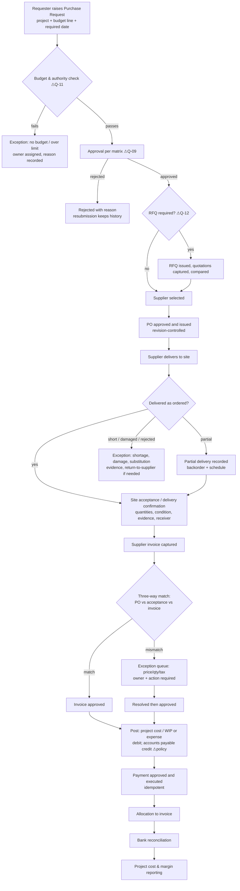
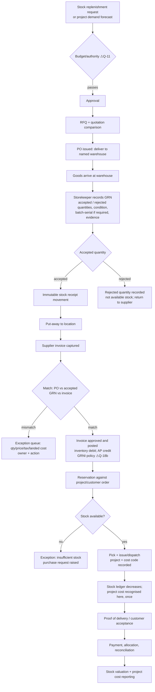
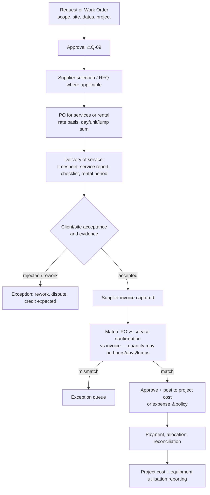
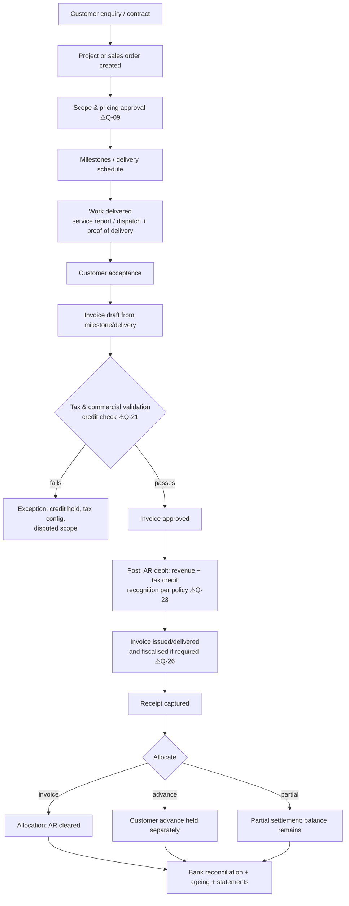

# Workflows: The Three Procurement Routes, Order-to-Cash, Stock and Cash

**Version:** 0.1 — draft for departmental walkthrough, 11 November 2026
**Guide references:** §2 (operating model), §3 (end-to-end workflows), §15.4
**Status:** Each route must be walked through with the department that performs it. Steps marked ⚠ depend on an unresolved decision.

---

## 1. Route A — Direct-to-project purchase

The purchase is for a named project and is delivered to the project site or a client-designated location. Its cost belongs to the project, not to stock.

Key controls: no PO without an approved request (unless direct-PO authority exists — ⚠Q-13); acceptance quantity ≤ delivered; invoice matched before posting; **cost is recognised once** — the supplier payment does not create a second expense.

## 2. Route B — Warehouse purchase and issue to project

The purchase replenishes stock; the cost reaches the project **at issue**, not at invoice posting.

Key controls: rejected goods never increase available stock; GRNI (goods received not invoiced) treatment requires accountant approval; landed costs (freight, duty, clearing) allocation requires approval — **not assumed**; issue is the only point a warehouse purchase reaches project cost.

## 3. Route C — Services, labour, logistics and equipment leasing

No stock quantity exists. Acceptance is a service confirmation.

Equipment leasing additionally records: unit availability, dispatch to site, condition on dispatch and return, inspection findings, damage charges (which are separate, approved documents — not silently netted off the rental invoice).

## 4. Order-to-cash

## 5. Lifecycle states (PROPOSED — confirm)

Each state machine is implemented server-side with explicit permitted transitions per role. Illegal transitions must be rejected with a domain error, not silently ignored.

| Document | Proposed states |
| --- | --- |
| Purchase request | `DRAFT → SUBMITTED → UNDER_REVIEW → APPROVED / REJECTED → CONVERTED_TO_PO` (also `CANCELLED`, `CLOSED`) |
| RFQ | `DRAFT → ISSUED → CLOSED → AWARDED / CANCELLED` |
| Supplier quote | `RECEIVED → EVALUATED → SELECTED / NOT_SELECTED → EXPIRED` |
| Purchase order | `DRAFT → PENDING_APPROVAL → APPROVED → ISSUED → PARTIALLY_RECEIVED → FULLY_RECEIVED → CLOSED` (also `AMENDED` revision, `CANCELLED` with reason) |
| Goods receipt / delivery confirmation | `DRAFT → RECEIVED → QUALITY_CHECKED → ACCEPTED / PARTIALLY_ACCEPTED / REJECTED → POSTED` |
| Supplier invoice | `CAPTURED → MATCHED / EXCEPTION → APPROVED → POSTED → PARTIALLY_PAID → PAID` (also `DISPUTED`, `REVERSED`, `CREDITED`) |
| Payment | `DRAFT → PENDING_APPROVAL → APPROVED → EXECUTED → ALLOCATED` (also `FAILED`, `BOUNCED`, `REVERSED`) |
| Customer invoice | `DRAFT → VALIDATED → APPROVED → POSTED → DELIVERED → PARTIALLY_PAID → PAID` (also `CREDITED`, `DISPUTED`, `WRITTEN_OFF` pending approval) |
| Receipt | `CAPTURED → ALLOCATED / UNALLOCATED → RECONCILED` |
| Stock movement | Terminal on creation (`POSTED`); corrected only by a new movement |
| Journal | `DRAFT → POSTED`; corrections only via `REVERSAL` documents linked to the original |
| Bank statement line | `IMPORTED → MATCHED / UNMATCHED → INVESTIGATING → RECONCILED` |
| Project | `PLANNED → ACTIVE → ON_HOLD → COMPLETED → CLOSED` |
| Work order | `DRAFT → ASSIGNED → IN_PROGRESS → COMPLETED → ACCEPTED → CLOSED` (also `CANCELLED`) |

Health/credit/hold states (`DISPUTED`, `ON_HOLD`) must not block the ability to reverse or correct a posting.

## 6. Exception paths (Guide §3 requires every one of these to be defined)

| Exception | Trigger | System behaviour | Owner (proposed) |
| --- | --- | --- | --- |
| Missing / exceeded budget | Request submission or PO approval | Route to exception with budget position shown; approval by authorised over-budget approver if policy allows ⚠Q-11 | Project manager + Finance |
| Supplier quotation variance | Recommendation differs from cheapest/compliant quote | Require written justification before approval | Procurement |
| Expired supplier compliance document | PO creation or invoice approval | Block or warn per policy ⚠Q-16 | Procurement / HSE |
| PO / invoice mismatch | Three-way match fails | Exception queue with line-level differences | Procurement / Accounts |
| Damaged or short delivery | Receiving or site acceptance | Record rejected quantity, evidence, replacement/backorder | Storekeeper / Project manager |
| Rejected goods return | Supplier return initiated | Separate movement/document; stock and AP impact visible | Storekeeper + Accounts |
| Insufficient stock at issue | Availability check fails | Block issue, show availability, offer purchase request | Storekeeper |
| Overdue approval | Time threshold exceeded | Escalation notification to approver and their delegate | Document owner |
| Payment failure / bounce | Execution or bank statement | Payment state `FAILED`/`BOUNCED`, invoice balance re-opened, fee journal | Accounts |
| Duplicate supplier invoice | Supplier + number match | Block with original reference; override needs elevated approval | Accounts |
| Closed accounting period | Posting date in locked period | Reject with period status; route to reopen request ⚠Q-22b | Accountant |
| Failed NRS submission | Adapter error/timeout | Retry with idempotency; status tracked; invoice flagged | Accounts / tax adviser |
| Unmatched bank line | Import/matching | Remains visibly unresolved; investigation note required before reconciliation approval | Accounts |
| Stock count variance | Count differs | Variance review + approval before adjustment posts | Storekeeper + Finance |
| User loses permission mid-process | Session/permission change | In-flight actions fail authorisation safely; no partial posting | Administrator |

Every exception item must display: what happened, which document, who owns it, what action is required, and how long it has been open.

## 7. Cash and allocation workflow

1. Payment/receipt captured with real-world reference and evidence.
2. Approval (payment) or acceptance (receipt) per policy.
3. Allocation to one or many documents, or to advance.
4. Execution/posting with idempotency key.
5. Bank statement import and matching.
6. Reconciliation approval; unmatched items remain visible.
7. Period close report listing unreconciled and unmatched items.

Constraints: allocation cannot exceed remaining document balance; a reversed payment releases its allocations; an advance converted to settlement is recorded as an allocation event, not by editing the original receipt.

## 8. Sequences requiring confirmation (⚠)

Each of these changes the build materially and is tracked in `11-questions.md`:

1. Are quotations required for every purchase above some value, and who evaluates them? (Q-12)
2. Can a PO be raised without a purchase request? If so, for whom and up to what value? (Q-13)
3. Is one PO ever split across warehouse and project site, and how? (Q-15)
4. Who physically receives goods, and where is evidence stored? (Q-16)
5. Is over-delivery ever accepted, and within what tolerance? (Q-17b)
6. Does the accountant want GRNI as a holding account, or invoice-first posting? (Q-18b)
7. Which documents are required to exist as scanned evidence before approval? (Q-20)
8. Are bank payments executed by the system (recorded only) or outside it? (Q-33)
9. Are customer receipts matched to bank statements by finance staff daily, weekly, monthly? (Q-33b)
10. Which approvals can be delegated, and does delegation need management sign-off? (Q-10)
