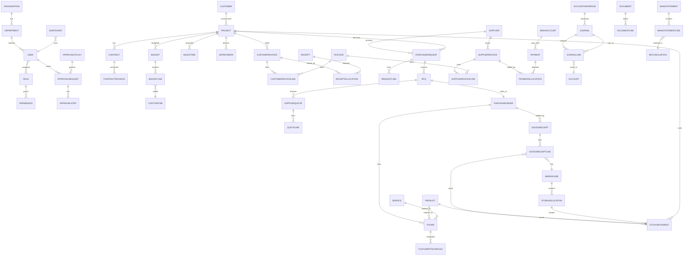

# Preliminary Data Model, ERD and Data Dictionary

**Version:** 0.1 — 11 November 2026
**Guide references:** §5 (core data model), §15.6
**Status:** Preliminary. Field-level lists below cover the entities the brief names plus constraints it requires. The **full ERD is a Phase 4 deliverable** (Guide §5: "The exact ERD must be produced during design"), because entity details depend on the workflow answers in `11-questions.md`.

---

## 1. Modelling principles (mandatory)

| # | Principle | Implementation intent |
| --- | --- | --- |
| M-01 | Stable internal IDs; human-readable document numbers separate | `id` (UUID or bigint) primary key; `number` unique per organisation and generated by a numbering service |
| M-02 | Every business document has a lifecycle state with permitted transitions validated server-side | `status` + transition table/service; illegal transition raises a domain error |
| M-03 | Money and quantities use fixed-precision decimals with documented precision and rounding | `NUMERIC` columns; Python `Decimal`; no float anywhere |
| M-04 | Effective dates and historical versions preserved for price, tax, approval and contract data | `effective_from/effective_to` or version tables; posted documents store their applied values as snapshots |
| M-05 | Soft deactivation instead of deletion for referenced master data | `is_active` flag; deletion refused when references exist |
| M-06 | Source transaction, approval, evidence, inventory event and journal stay linked | explicit FK/relation on each posted record; journal lines carry source type/id |
| M-07 | Unique constraints for document numbering and duplicate supplier invoice detection | DB unique constraints, company-scoped |
| M-08 | Audit columns on every table | `created_by`, `created_at`, `updated_by`, `updated_at`, `version` (optimistic locking) |
| M-09 | Append-only tables for audit and stock movements | no UPDATE/DELETE grants for the application role on those tables where feasible |
| M-10 | Domain separation | procurement, inventory, projects, billing, payments, accounting, compliance, reporting communicate via documented service interfaces and domain events |

## 2. Entities by domain (from Guide §5)

| Domain | Entities |
| --- | --- |
| Organisation & identity | Organisation, Department, User, Role, Permission, ApprovalPolicy, ApprovalRequest, ApprovalStep, Delegation |
| Projects | Project, Contract, ContractRevision, Budget, BudgetLine, CostCentre, Milestone, WorkOrder |
| Partners | Customer, Supplier, Contact, Address, BankAccount, TaxRegistration, ComplianceDocument |
| Catalogue | Product, Service, UnitOfMeasure, ProductCategory |
| Inventory | Warehouse, StorageLocation, StockLot, SerialNumber, StockMovement, StockReservation, StockCount, StockCountLine |
| Procurement | PurchaseRequest, RequestLine, RFQ, SupplierQuote, QuoteLine, PurchaseOrder, POLine, FulfilmentSchedule, GoodsReceipt, GoodsReceiptLine, DeliveryConfirmation, SupplierReturn |
| Billing (AP/AR) | SupplierInvoice, SupplierInvoiceLine, SupplierCreditNote, CustomerInvoice, CustomerInvoiceLine, CustomerCreditNote |
| Payments | Payment, PaymentAllocation, Receipt, ReceiptAllocation |
| Accounting | Account, Journal, JournalLine, AccountingPeriod, TaxCode, BankStatement, BankStatementLine, Reconciliation, ExchangeRate |
| Governance | Document, DocumentLink, AuditEvent, Notification, IntegrationEvent, IdempotencyRecord, NumberSequence, SystemSetting |

Additional entities implied by the brief and needed for correctness (proposed):

- `GoodsReceivedNotInvoiced` accrual records (or handled purely via journal roles — Q-18b).
- `ProjectCostLedger` / cost-entry projection (or derived views — decide in Phase 5).
- `Asset`, `AssetRental`, `AssetMaintenance`, `AssetInspection` (equipment leasing).
- `StockTransfer` (paired movements), `StockAdjustmentRequest`.
- `ServiceConfirmation`, `Timesheet`/`LabourEntry` (if labour is tracked — Q-27).
- `FiscalSubmission` (NRS adapter state per invoice).
- `ReconciliationException`.

## 3. Core ERD (preliminary, simplified)

This diagram is intentionally structural. Cardinalities that depend on unresolved operations (e.g. one PO → many destinations, one invoice → many POs) are marked in §6.

## 4. Data dictionary — critical fields and constraints

Money precision proposal: `NUMERIC(18,2)` for NGN amounts, `NUMERIC(18,6)` for unit prices and rates, quantities `NUMERIC(18,4)`. Rounding: half-up at line level, totals recomputed not summed from rounded values where policy requires (accountant to confirm — Q-22c).

| Entity | Field | Type | Rules |
| --- | --- | --- | --- |
| PurchaseOrder | `number` | varchar(32) | unique per organisation; generated from NumberSequence; immutable after issue |
| PurchaseOrder | `status` | enum | transition-validated; see `04-workflows.md` §5 |
| PurchaseOrder | `supplier_id`, `project_id`, `currency`, `total_amount`, `approved_by`, `approved_at`, `version` | mixed | approved fields immutable except via revision |
| POLine | `quantity_ordered`, `quantity_received`, `quantity_accepted`, `quantity_invoiced`, `unit_price`, `tax_code_id`, `cost_centre_id`, `destination_type` | numeric/enum | all four quantities distinct and non-negative; accepted ≤ received ≤ ordered + approved tolerance |
| GoodsReceiptLine | `quantity_delivered`, `quantity_accepted`, `quantity_rejected`, `reason`, `location_id` | numeric | accepted + rejected ≤ delivered; posting creates stock movement |
| StockMovement | `item_type`, `item_id`, `warehouse_id`, `location_id`, `movement_type`, `quantity` (signed), `unit_cost`, `source_type`, `source_id`, `project_id`, `posted_at` | mixed | append-only; quantity sign convention documented; no direct balance edit endpoint |
| StockReservation | `item_id`, `warehouse_id`, `quantity`, `project_id`, `status`, `expires_at` | numeric | available = on-hand − reserved − quarantined; cannot exceed available |
| SupplierInvoice | `supplier_id`, `supplier_invoice_number`, `invoice_date`, `due_date`, `currency`, `subtotal`, `tax_total`, `total`, `status`, `match_status` | mixed | unique (`supplier_id`, `supplier_invoice_number`) with configurable override; posted fields immutable |
| SupplierInvoiceLine | `quantity`, `unit_price`, `line_total`, `tax_code_id`, `project_id`, `cost_centre_id`, `po_line_id`, `grn_line_id` | numeric | three-way match uses these references |
| Payment | `number`, `method`, `reference` (unique), `amount`, `currency`, `bank_account_id`, `status`, `executed_at`, `idempotency_key` | mixed | reference unique; execution idempotent; allocations ≤ amount |
| PaymentAllocation | `payment_id`, `supplier_invoice_id`, `amount` | numeric | sum(allocations) ≤ payment amount; sum ≤ invoice balance |
| CustomerInvoice | `number`, `customer_id`, `project_id`, `milestone_id`, `invoice_date`, `due_date`, `currency`, `subtotal`, `tax_total`, `total`, `status`, `delivery_status` | mixed | number sequence per fiscal year; posting atomic with journal |
| Receipt | `number`, `customer_id`, `amount`, `received_on`, `bank_account_id`, `reference`, `status` | mixed | unallocated remainder tracked explicitly |
| Journal | `number`, `journal_date`, `period_id`, `source_type`, `source_id`, `status`, `reversal_of_id`, `currency`, `total_debit`, `total_credit` | mixed | total_debit = total_credit enforced; posted immutable; unique per (source_type, source_id, reversal flag) for idempotency |
| JournalLine | `journal_id`, `account_id`, `debit`, `credit`, `description`, `project_id`, `cost_centre_id`, `tax_code_id`, `party_type`, `party_id` | numeric | exactly one of debit/credit non-zero; ≥2 lines per journal (DB + service check) |
| Account | `code`, `name`, `type`, `parent_id`, `is_postable`, `currency`, `is_active` | mixed | supplied and approved by accountant; postable flag prevents posting to headers |
| AccountingPeriod | `code`, `start_date`, `end_date`, `status` | mixed | posting rejected when locked; no overlapping periods |
| TaxCode | `code`, `name`, `rate`, `treatment`, `effective_from`, `effective_to`, `source_reference`, `approved_by` | mixed | rate is configuration data, never a code literal |
| ComplianceDocument | `supplier_id`, `document_type`, `issue_date`, `expiry_date`, `document_id`, `verified_by`, `status` | mixed | expiry drives PO/invoice blocking per approved policy |
| ApprovalRequest | `document_type`, `document_id`, `policy_id`, `status`, `requested_by`, `decided_at`, `reason` | mixed | one open request per document; decisions append `ApprovalStep` |
| AuditEvent | `actor_id`, `action`, `entity_type`, `entity_id`, `before`, `after`, `reason`, `correlation_id`, `occurred_at` | json/mixed | append-only; indexed by entity and by actor |
| IdempotencyRecord | `key`, `scope`, `request_hash`, `response_ref`, `created_at` | mixed | unique key per scope; reused key with different payload is rejected |
| Document | `category_id`, `filename`, `mime_type`, `size`, `checksum`, `storage_key`, `uploaded_by`, `retention_until`, `is_private` | mixed | private storage only; download through permission-checked endpoint |

## 5. Constraints and indexes to add deliberately

- Unique: document numbers (per organisation, per type, per fiscal year where applicable), supplier invoice number within supplier, payment reference, journal (source event), idempotency key.
- Check: quantity ≥ 0 on document lines; debit/credit mutual exclusivity; `quantity_accepted <= quantity_delivered`; journal balance; `total = subtotal + tax_total` at line/total level with rounding policy.
- Index: stock movement by (item, warehouse, location, posted_at); journal line by (account, period); invoice by (supplier, due_date, status); audit by (entity_type, entity_id, occurred_at); approval request by (status, requested_by).
- Foreign keys restricted (`PROTECT`) on posted/financial records to prevent cascade deletion.

## 6. Cardinalities requiring confirmation

| Question | Impact |
| --- | --- |
| Can one PO have multiple destinations (site + warehouse)? (Q-15) | Adds split-quantity fulfilment records or child POs |
| Can one supplier invoice cover multiple POs? (Q-20b) | Changes invoice ↔ PO matching from 1:1 to M:N join table |
| Can one GRN cover multiple POs? | Same as above for receipts |
| Are projects ever shared across legal entities? (Q-04) | Adds organisation scoping on nearly every table |
| Is cost code hierarchical? (Q-14b) | `CostCentre.parent_id` and report rollups |
| Do customers pay in instalments against a contract rather than invoices? (Q-23b) | Adds contract-level balance tracking |
| Is an item always owned (never customer-supplied)? (Q-17c) | Otherwise stock ownership flag on movements/lots |

## 7. Indexes, retention and archival

- Transactional tables are never purged in release 1; archival is a reporting concern.
- Audit and stock movement tables grow monotonically; partition by year if volume requires (measure first, no premature work).
- Document retention periods are UNRESOLVED (Q-28) and must be configuration, not code.

## 8. Next step

After the Phase 0 interviews, this document becomes the **full ERD and data dictionary** (Phase 4 deliverable), including field-level definitions for every entity in §2, drawn from actual TMD documents (blank/redacted samples) so that recorded fields match reality.
