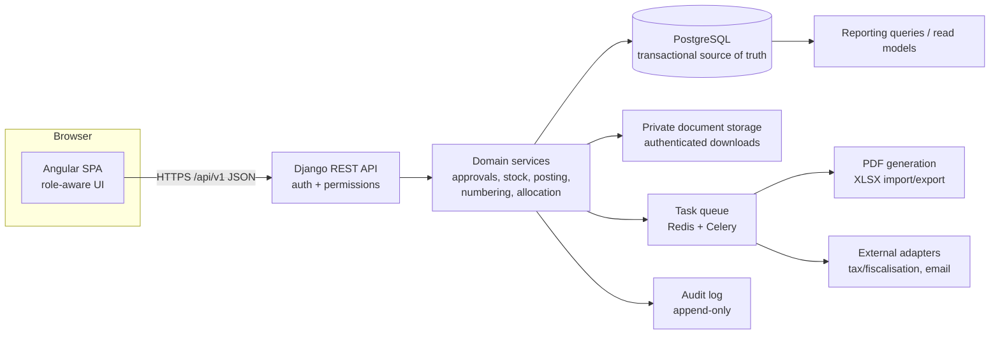

# Architecture Proposal

**Version:** 0.1 — 11 November 2026
**Guide references:** §7 (recommended technical architecture), §5 (boundaries)
**Status:** PROPOSED. Stack choices are the brief's recommendation and require confirmation (D-09). No code has been generated.

---

## 1. Shape of the system

A **modular monolith**: one deployable Django backend, clean internal domain modules, explicit service layers, REST API, and one Angular frontend. No microservices, no message broker beyond task queues, no event sourcing.

Rationale (from the brief and unchanged by me): a single well-structured deployable backend is easier to secure, test, back up and operate for a first release; measurable scaling or team-boundary pressure should justify splitting later, and neither exists yet.



## 2. Layers and responsibilities

| Layer | Responsibility | Must not do |
| --- | --- | --- |
| API (views/serialisers) | HTTP concerns, authentication entry, permission check, input validation, response shaping | Contain business rules or SQL-heavy reporting logic |
| Domain services | Approvals, stock movements, posting, allocation, numbering, matching, lifecycle transitions | Depend on request objects; write raw SQL outside repository/ORM conventions |
| Models | Schema, invariants, DB constraints, clean() validation | Own cross-aggregate workflows |
| Repositories/selectors | Query composition for reads and reports | Mutate state |
| Tasks | Asynchronous work (PDFs, imports, retries, reminders) | Be the only place a rule exists |
| Frontend | Presentation, forms, client-side validation as convenience | Compute balances, prices, tax or journal entries |

## 3. Technology decisions (PROPOSED)

| Layer | Choice | Notes |
| --- | --- | --- |
| Frontend | Angular + TypeScript + Angular Material | Typed reactive forms, role-aware navigation, reusable tables |
| Backend | Python 3.13 + Django + Django REST Framework | Mature modelling, permissions, migrations |
| Database | PostgreSQL | Decimal types, transactions, row locking, indexes, reporting |
| Async | Redis + Celery | PDF generation, scheduled reminders, imports/exports, integration retries |
| Documents | Private object/file storage behind authenticated endpoints | No public static URLs (Guide §7) |
| PDFs | WeasyPrint or ReportLab | Decision deferred to Phase 7 (Q-31) |
| Spreadsheets | openpyxl | Validated import/export templates with rejected-row reporting |
| Charts | Chart.js | Dashboards |
| Deployment | Docker Compose locally; Docker images for staging/production on a controlled host | Separate config per environment |
| CI | GitHub Actions | Lint, type check, tests, security scan, migration check |
| API docs | OpenAPI generated from DRF | Versioned `/api/v1` |

Version pinning, linting/formatting rules and test framework choices are Phase 1 deliverables; they do not need a business decision.

## 4. Domain modules (Django apps)

`organisation`, `identity` (users/roles/permissions), `partners` (customers, suppliers, contacts, addresses, bank accounts, compliance documents), `catalogue` (products, services, UoM, categories), `projects` (projects, contracts, budgets, cost centres, milestones), `procurement` (requests, RFQ, quotes, POs, schedules, receipts, returns), `inventory` (warehouses, locations, movements, reservations, counts, valuation), `billing` (supplier invoices, customer invoices, credit notes), `payments` (payments, receipts, allocations, advances), `ledger` (accounts, periods, journals, posting rules, reports), `banking` (accounts, statements, matching, reconciliation), `taxation` (tax codes, fiscal adapter), `workorders` (services, checklists, service reports), `assets` (equipment register, rentals, maintenance), `reporting` (read models, exports), `documents`, `audit`.

Cross-module communication rules:

- A module may call another module's **service interface**, never its internals or its tables directly.
- Financial side effects are emitted as **domain events** handled by the posting service.
- Circular dependencies are refactored, not worked around with imports inside functions as a pattern.

## 5. Cross-cutting components

| Component | Design |
| --- | --- |
| Numbering service | Atomic per (organisation, document type, fiscal year); gaps not reused; number never typed by a user; issued at approval/issue time per policy |
| Money type | `Decimal` with explicit quantisation; single helper module for rounding; currency + precision on every amount context |
| Permission layer | DRF permission classes + object-level checks; single matrix test suite |
| Approval engine | Data-driven `ApprovalPolicy`; evaluates amount/scope; creates `ApprovalRequest`/`ApprovalStep`; blocks self-approval |
| Posting engine | Central, rule-driven, idempotent, transactional (see `07-accounting-events.md` §4) |
| Audit service | Append-only writes with correlation IDs; no update/delete paths |
| Idempotency | Middleware/service for posting, payment execution, integration callbacks |
| Document service | Upload validation (MIME, size, extension), private storage keys, permissioned streaming, checksums |
| Notification service | In-app notifications first; email optional; failures never block business transactions |

## 6. Repository structure (proposed)

```
tmd-platform/
├── backend/
│   ├── config/            settings (base/dev/staging/prod), urls, wsgi/asgi, celery
│   ├── apps/              domain modules listed in §4
│   ├── shared/            money, numbering, permissions, audit, documents, events, exceptions
│   ├── manage.py
│   └── pyproject.toml
├── frontend/              Angular workspace (apps/tmd-portal, libs/)
├── infra/
│   ├── docker-compose.yml
│   ├── docker/            Dockerfiles
│   ├── deployment/        environment templates, reverse proxy config
│   └── backup/            backup and restore scripts
├── docs/                  this pack + future BRD/SRS/ERD/runbooks/manuals
├── tests/                 cross-cutting integration and E2E support
└── .github/workflows/      ci.yml, security.yml
```

## 7. Environments and configuration

| Environment | Purpose | Data | Secrets |
| --- | --- | --- | --- |
| Local | Development | Synthetic only | `.env` (git-ignored) |
| Staging/UAT | Departmental acceptance | Synthetic or masked data | Separate secret set |
| Production | Live operations | Real | Managed secrets; rotated |

Rules: no shared credentials; no production data copied to development; production database not publicly reachable; migrations committed and rehearsed; release requires documented rollback.

## 8. Observability and operations (pre-production requirements)

- Health/readiness endpoints; structured JSON logs with request IDs; error tracking with alerting.
- Metrics: request latency, error rate, queue depth, failed tasks, DB capacity.
- Audit of exports and document downloads.
- Scheduled jobs: backup verification, reminder emails, integration retries, ageing snapshots.
- Runbooks for restore, rollback, failed job retry, incident response (Phase 12 deliverable).

## 9. Non-goals for release 1

Microservices, GraphQL, event sourcing, real-time collaborative editing, offline-first PWA, mobile native apps, public API for third parties, supplier/customer portals.

## 10. Technical risks in this proposal

| Risk | Mitigation |
| --- | --- |
| Angular + Django split raises frontend build complexity for a small team | Keep one workspace, one CI, generated API types, minimal custom state management |
| Reporting queries slow down transactional tables | Read-only report views, indexes designed with reports, async export for heavy reports |
| Posting engine becomes a god-service | Rule-driven configuration plus per-event handlers registered into a small registry |
| Celery adds operational surface | Only for PDFs/imports/retries in release 1; run in the same host initially with monitoring |
| Site internet constraints | Confirm connectivity (Q-39); responsive pages designed for low bandwidth, no large bundles |

## 11. Decision needed

**D-09:** Confirm the stack above, or name an alternative. The brief's recommendation was designed for exactly this system, so the default is to proceed with it. This decision should be confirmed before Phase 1 scaffolding so the repository is not rebuilt later.
