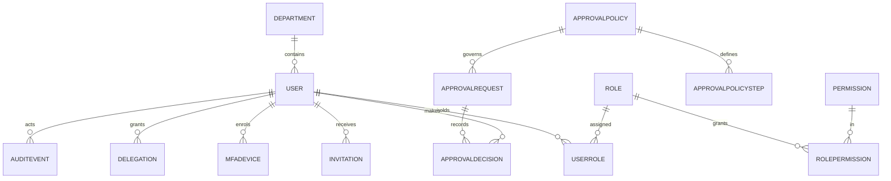
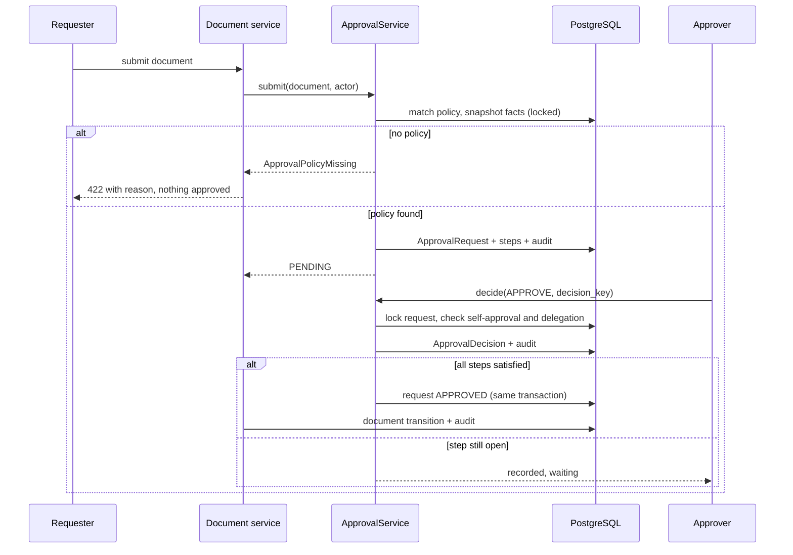

# Phase 2 Design: Identity, Authorisation, Approval and Audit

**Version:** 1.0 — 11 November 2026
**Guide references:** §4 (approvals), §8 (security), §9 Phase 2
**Status:** **PROPOSED design.** No code has been written, no policy value is set, and no limit is guessed.
**Blocked by:** D-03, D-04, D-04a, D-04b, D-17, D-18 (management), Q-07, Q-08, Q-36 (MFA). See `13-decision-register.md`.
**Requirements covered:** ADM-01…ADM-11, AUD-01, AUD-02, NFR-05, S-01…S-06, S-10, S-11.

---

## 1. What Phase 2 delivers, and what it deliberately does not

Phase 2 builds the machinery that every later module relies on: who a user is, what they may do, who must approve a document, and what record proves it happened.

| In scope | Out of scope (later phases) |
| --- | --- |
| Custom user model, invitations, login, MFA, lockout, disablement | Business documents of any kind |
| Roles, permissions, department scoping, restricted fields | Supplier/customer master data (Phase 3) |
| Approval policy engine, maker-checker, delegation, escalation | Amounts, tax codes, posting rules |
| Append-only audit trail with integrity checking | Document uploads and downloads (Phase 3) |
| Access-administration UI (users, roles, approval policies) | Procurement, stock, billing, ledger screens |
| Permission matrix test suite and meta-tests | Financial reports |

The boundary matters: **the engine is built now; the rules that feed it arrive later as data.** A policy with no rows is a safe, non-approving system, not a broken one.

### 1.1 Requirement coverage

| Requirement | Where this design satisfies it |
| --- | --- |
| ADM-01 create/update/disable/offboard, never hard-delete | §3.1, §3.6 |
| ADM-02 password policy, lockout/rate limiting | §3.3 |
| ADM-03 time-limited single-use reset token | §3.4 |
| ADM-04 secure sessions, CSRF, secure cookies | §3.2 |
| ADM-05 roles bundle permissions, multiple roles per user | §4.2 |
| ADM-06 module/action/record-level checks | §4.3, §4.4 |
| ADM-07 maker-checker with self-approval blocked | §5.6 |
| ADM-08 limits as data, configuration audited | §5.2, §5.5 |
| ADM-09 bounded delegation, both identities recorded | §5.7 |
| ADM-10 append-only audit of the named event classes | §6 |
| ADM-11 department/cost-centre assignment, visibility restriction | §4.4 |
| AUD-01/02 tamper refusal, export permission, document access logging | §6.3, §6.7 |
| NFR-05 every mutating API permission- and scope-checked | §4.3, §10.2 |
| S-01…S-06, S-10, S-11 | §3, §4, §6, §10 |
| S-07 mass assignment, IDOR, CSRF | §4.5, §10.3 |

---

## 2. Architecture decisions

Each is recorded as a build decision (B-11…B-18) because reversing one later costs real work.

| # | Decision | Rationale | Rejected alternative |
| --- | --- | --- | --- |
| A1 | **Custom user model from the first Phase 2 migration**, email as the login identifier | Retrofitting `AUTH_USER_MODEL` after domain tables exist is painful; email matches how staff actually log in and avoids a separate username nobody remembers | Django's default `User` with a profile table |
| A2 | **Session-cookie authentication with CSRF**, not bearer tokens in browser storage | Sessions can be revoked instantly on disablement or role change; nothing sensitive sits in `localStorage` where XSS can read it; the SPA is same-origin | JWT in localStorage/IndexedDB |
| A3 | **Permissions as data** with stable codenames; no `if user.role == "accountant"` anywhere | The matrix in `05-roles-permissions-approvals.md` is expected to change; code must not | Hard-coded role checks |
| A4 | **Approval policies are versioned and snapshotted onto each request** | A limit change must never silently re-decide an in-flight approval | Reading the current policy at decision time |
| A5 | **Audit trail is hash-chained and write-protected at the database level** | "Append-only" enforced only in Python is a promise, not a control (S-11) | ORM-level restriction alone |
| A6 | **Django admin is off in production by default**, enabled only as a named, audited break-glass | The admin is a second, less-controlled path to the same data | Leaving `/admin/` open to staff users |
| A7 | **Segregation-of-duties rules are registered checks**, evaluated with immutable document facts | Rules span modules (supplier creator vs payment approver) and cannot live in one view | Inline conditionals per endpoint |
| A8 | **Use `django-axes` for lockout and `django-otp` for TOTP** rather than writing security primitives | Proven implementations; a hand-rolled lockout is a vulnerability waiting to happen | Custom throttle and TOTP code |

**Consequence of A1, stated plainly:** switching `AUTH_USER_MODEL` requires resetting the development database, because Django's built-in `auth` tables were already migrated in Phase 1. There is no production or staging data, so this costs nothing — but the reset must never be run against an environment holding real records.

```bash
# Development only. Destroys the local database volume.
docker compose -f infra/docker-compose.yml down -v
docker compose -f infra/docker-compose.yml up -d
cd backend && python manage.py migrate
```

---

## 3. Identity

### 3.1 Entities

`User` (app `identity`) — from the first migration, referenced by `AUTH_USER_MODEL = "identity.User"`.

| Field | Type | Rules |
| --- | --- | --- |
| `id` | bigint PK | Internal only, never shown as an identifier to staff |
| `email` | varchar(254), unique | Normalised to lower case on save; the login identifier |
| `full_name` | varchar(150) | Required |
| `employee_ref` | varchar(30), blank | TMD's own staff reference, if one exists (not invented) |
| `department` | FK → Department, `PROTECT`, null | Nullable only for the first administrator |
| `is_active` | boolean | `False` blocks authentication immediately |
| `is_staff` | boolean | Django admin access only; not a business role |
| `must_change_password` | boolean | Set on invitation and on administrator reset |
| `mfa_required` | boolean | Derived from role policy once Q-36 is answered |
| `date_joined`, `last_login` | timestamps | Audit-adjacent, not authoritative (audit trail is) |

No `username`, no password history in the user row, no personal data beyond what payroll does not already hold.

`Invitation`: `email`, `token_hash` (SHA-256, never the raw token), `expires_at`, `created_by`, `accepted_at`, `revoked_at`. Single use; accepting it sets the password and activates the account.

`MfaDevice`: `user`, `secret` (encrypted at rest with a key from the environment), `confirmed_at`, `last_used_at`.
`MfaRecoveryCode`: `user`, `code_hash`, `used_at` — ten single-use codes issued at enrolment.

`LoginThrottle` (via `django-axes`): failures by username and IP, lockout window, reset on success. Thresholds are configuration (D-36), not constants.

`Department`: `code`, `name`, `parent` (self-FK), `is_active`. Cost centres arrive with master data in Phase 3; Phase 2 only needs departments for scoping.

### 3.2 Authentication and sessions

- Login: `POST /api/v1/auth/login` with email + password. Response sets an `HttpOnly`, `Secure` (deployed), `SameSite=Lax` session cookie and a readable `csrftoken` cookie.
- Every mutating request must send `X-CSRFToken`. DRF's `SessionAuthentication` enforces this; tests assert a missing token returns 403.
- Idle timeout and absolute session lifetime are settings (D-36). Password change, role change and disablement invalidate existing sessions (session auth hash rotation / explicit session deletion).
- `GET /api/v1/auth/me` returns the caller's identity, roles, resolved permissions and scope — the SPA needs nothing else to shape navigation. It is not a security boundary; the backend re-checks every request.
- Unauthenticated access to any private endpoint returns `401 not_authenticated`, never a redirect to a login page (the SPA handles routing).

### 3.3 Password policy and lockout

- Hashing: Argon2 (Django's `Argon2PasswordHasher` first in `PASSWORD_HASHERS`), parameters in settings.
- Validators: Django's four validators plus a configurable minimum length. Values are configuration (D-36), not code.
- Lockout after repeated failures; `django-axes` handles both per-account and per-IP counters so that a single attacker cannot lock out the whole finance team by hammering one email from many addresses (per-IP limit) nor rotate accounts from one address (per-account limit).
- Administrator unlock is possible and **audited** with a reason.

### 3.4 Password reset

Phase 2 has no outbound email dependency (see `12-integrations.md`). Reset is therefore administrator-issued: an administrator generates a single-use, time-limited link and delivers it out-of-band. The token is stored hashed, expires, and is invalidated by its own use or by any password change. When email is available, the same service gains a self-service route without changing the token model.

### 3.5 First administrator

A management command `create_initial_admin` creates the first account from environment-provided values or an interactive prompt, records an audit event, and requires a password change at first login. It refuses to run if any user already exists, so it cannot be used to plant a second backdoor.

### 3.6 Disablement and offboarding

Disabling an account (`is_active = False`) takes effect on the next request because the authentication backend rejects inactive users and their sessions are deleted. Offboarding is a single service call that, in one transaction:

1. disables the user and deletes their sessions,
2. revokes their delegations (granted and received),
3. reassigns their pending approval steps to their department's approver role, recording the reassignment,
4. writes an audit event naming the actor, the reason and what was reassigned.

Accounts with activity are never deleted (ADM-01). A user with no activity may be deleted only by a database administrator, outside the application.

---

## 4. Authorisation

### 4.1 Permission codenames

Format: `<module>.<resource>.<action>`, lowercase, stable, never renamed without a migration that remaps role grants.

Phase 2 defines the access-administration set; later modules add their own.

| Codename | Meaning | Default holders |
| --- | --- | --- |
| `identity.user.read` | View users and their role assignments | R-ADM, R-MGT, R-AUD |
| `identity.user.create` | Invite a user | R-ADM |
| `identity.user.update` | Edit name, department, employee ref | R-ADM |
| `identity.user.disable` | Disable / offboard | R-ADM |
| `identity.user.assign_role` | Change role assignments | R-ADM (audited, cannot grant self) |
| `identity.role.read` | View roles and their permissions | R-ADM, R-MGT, R-AUD |
| `identity.role.manage` | Create/edit roles and grants | R-ADM |
| `identity.delegation.read` | View delegations | R-ADM, R-MGT, R-AUD |
| `identity.delegation.manage` | Grant/revoke delegations | R-MGT, R-ACC (per D-18) |
| `approval.policy.read` | View approval policies | R-ADM, R-MGT, R-ACC, R-AUD |
| `approval.policy.manage` | Create/retire policy versions | R-MGT, R-ACC |
| `approval.request.read_own` | See own submissions | every authenticated user |
| `approval.request.read_inbox` | See approvals assigned to the caller | holders of any approving role |
| `approval.request.read_all` | See every approval | R-MGT, R-ACC, R-AUD |
| `approval.request.decide` | Record an approval decision | R-MGT, R-ACC and other approving roles |
| `audit.event.read` | Read the audit trail | R-ADM, R-MGT, R-ACC, R-AUD |
| `audit.event.export` | Export audit events | R-MGT, R-AUD |

`organisation.department.read` / `.manage` are added here because scoping needs them; the rest of the organisation module arrives in Phase 3.

### 4.2 Roles and assignments

`Role`: `code` (unique, e.g. `R-ACC`), `name`, `description`, `is_system` (system roles cannot be deleted, only re-granted), `is_active`.
`Permission`: `code` (unique), `module`, `resource`, `action`, `description`.
`RolePermission`: `role`, `permission`, unique together.
`UserRole`: `user`, `role`, `department` (nullable), `valid_from`, `valid_to`, unique on (`user`, `role`, `department`) among active rows.

A user's effective permissions are the **union** of permissions from active roles whose assignment window covers now. Phase 2 has no explicit deny rules: negative control comes from not granting, which keeps the resolution algorithm auditable. Multi-role holders are supported (ADM-05), and the combination that matters — R-ADM plus an approving role — is flagged on the user screen because it is a segregation-of-duties risk (`05-…` §7).

### 4.3 Five enforcement layers

A single check is not enough; each layer catches what the others miss.

| Layer | Mechanism | Catches |
| --- | --- | --- |
| 1. Endpoint | `permission_classes` on every view, generated from the registry | Calling an endpoint at all without the right |
| 2. Object | `has_object_permission` using the scope resolver | Reaching a record outside the caller's department/project |
| 3. Query | `visible_to(user)` queryset scope applied in every list/detail selector | IDOR through enumeration, filters or exports |
| 4. Field | Serializer field classes requiring a specific permission (e.g. bank details) | Over-exposure inside a record the caller may otherwise see |
| 5. Service | State-transition guards that re-check permission and approval state | Bypassing workflow by PATCHing `status` |

Defaults fail closed: `DEFAULT_PERMISSION_CLASSES = IsAuthenticated` (already in Phase 1) and every view must declare a permission or be on an explicit allowlist (`/health/`, `/health/ready/`, `/api/v1/schema/`, `/api/v1/docs/`).

**Meta-test (write this first).** A test that walks the URL configuration and fails if any view lacks a permission class, or uses `AllowAny` without being on the allowlist. It turns "remember to secure the endpoint" into a build failure.

### 4.4 Record visibility (D-17, Q-07)

`AccessScope` resolves a user to:

- `department_ids` — their department and any explicitly granted departments,
- `project_ids` — from project membership (Phase 3 entity; empty until then),
- `mode` — `ALL`, `DEPARTMENT`, `PROJECT` or `OWN`, from the assigned visibility policy.

`scoped_queryset(qs, user, owner_field="created_by", department_field="department")` applies the mode centrally. Phase 2 defaults to the **most restrictive** implemented mode so that an unanswered D-17 cannot leak data; raising visibility is a configuration change with an audit record.

### 4.5 Input and mass-assignment protection

- `status`, `approved_by`, `posted_at`, amounts and balances are never writable through a general serializer. They change only through a named service method that enforces the transition.
- Request bodies are validated by explicit serializers with declared fields; unknown fields are rejected rather than ignored.
- Role assignment accepts role codes from the registry only, and a user cannot grant themselves a role they do not administer.
- Every object URL resolves through the scoped queryset, so a foreign ID returns 404 (not 403), avoiding existence leaks.

---

## 5. Approval engine

### 5.1 Design intent

Approval is a **policy decision made from data**, recorded as an immutable chain of decisions, and consumed by the business service that owns the document. The engine never approves anything itself: it answers "is this document authorised, by whom, and on what policy version?" — and blocks the transition until the answer is yes.

### 5.2 Policy entities

`ApprovalPolicy`

| Field | Type | Rules |
| --- | --- | --- |
| `document_type` | varchar(40) | Registry value, e.g. `purchase_order`, `supplier_invoice` (populated in later phases) |
| `scope_type` | enum | `GLOBAL`, `DEPARTMENT`, `PROJECT` |
| `scope_id` | bigint, null | Required unless `GLOBAL` |
| `min_amount`, `max_amount` | numeric(18,2), null | `min` inclusive, `max` exclusive; null = unbounded; no overlaps within the same scope and version |
| `currency` | char(3) | NGN for release 1; present now so FX does not require a schema change |
| `version` | integer | Increments per (document_type, scope) |
| `status` | enum | `DRAFT`, `ACTIVE`, `RETIRED` |
| `effective_from`, `effective_to` | timestamps | Active window |
| `approved_by`, `approved_at` | FK/timestamp | A policy is not usable until approved by someone other than its author |
| `created_by`, `created_at` | | Audit columns |

`ApprovalPolicyStep`: `policy`, `sequence`, `required_role`, `required_count` (distinct users), `mode` (`ALL` = every role in the step must decide; `ANY` = any one). Steps run in sequence; a later step is not assignable until earlier steps complete.

`ApprovalRequest`: `document_type`, `document_id`, `document_version`, `amount`, `currency`, `department_id`, `project_id`, `policy` (FK), `policy_version` (integer snapshot), `requested_by`, `status` (`PENDING`, `APPROVED`, `REJECTED`, `CANCELLED`, `SUPERSEDED`), `submitted_at`, `decided_at`, `correlation_id`.

`ApprovalDecision`: `request`, `step`, `approver`, `delegated_from` (nullable), `decision` (`APPROVE`, `REJECT`), `comment`, `decided_at`, `request_id`, `ip_hash`, `decision_key` (unique idempotency key).

`Delegation`: `delegator`, `delegate`, `document_types` (JSON list), `max_amount` (nullable, cannot exceed delegator's own authority), `starts_at`, `ends_at`, `approved_by`, `revoked_at`.

`EscalationRule`: `policy`, `after_hours`, `action` (`NOTIFY`, `REASSIGN`), `target_role`. Escalation never auto-approves — it moves or chases the decision, never makes it.

### 5.3 Matching algorithm

Given a document's facts `(document_type, amount, currency, department_id, project_id, at)`:

1. Load `ACTIVE` policies for the `document_type` whose effective window contains `at` and whose band contains `amount`.
2. Keep the most specific scope: `PROJECT` beats `DEPARTMENT` beats `GLOBAL`.
3. If more than one policy remains at the same specificity, or bands overlap inside a version, **refuse to submit** with `ApprovalPolicyAmbiguous` and alert administrators. Guessing which limit applies is how unauthorised spending happens.
4. If nothing matches, refuse with `ApprovalPolicyMissing`. The document stays unapproved and the gap is visible, rather than falling back to "no approval needed".

Deterministic precedence and explicit failure are the two properties worth protecting here.

### 5.4 Submission

`ApprovalService.submit(document, actor)` runs inside one transaction:

1. Re-authorise the actor for the document's create/submit permission.
2. Capture document facts and freeze them on the request (A4) — amount, currency, department, project, version.
3. Match a policy (§5.3) and copy `policy_version`.
4. Build the step chain from the policy; resolve each step's eligible users through roles, excluding the requester and the document creator.
5. If a step resolves to nobody, refuse with `ApprovalNoEligibleApprover` — a policy that nobody can satisfy is a configuration defect, not an approval.
6. Write the request, steps, and audit events.
7. Notify eligible approvers (in-app notification; email only when available).

### 5.5 Amount and content changes

Any material edit after submission (amount, currency, supplier, project, department, lines) marks the existing request `SUPERSEDED`, creates a new request version, and re-runs matching. A decision recorded against the old version is never reused, and the audit trail shows both versions. This closes the "submit small, approve, then increase" fraud path.

### 5.6 Maker-checker and self-approval

Hard rules, enforced at decision time with facts snapshotted at submission:

| Rule | Enforcement point |
| --- | --- |
| The requester cannot approve their own request | Decision endpoint returns `403 SELF_APPROVAL_BLOCKED`, audited |
| The document creator cannot approve it | Same, using the creator snapshot |
| Required approvers must be distinct people | `required_count` counts distinct `approver` values |
| A role cannot both create and approve the same document type where the policy forbids it | `SeparationRule` registry (§5.8) |
| Administrator rights do not imply approval rights | R-ADM holds no `approval.request.decide` by default |

A blocked attempt is logged with the actor, document and reason — repeated attempts are a signal worth seeing, not noise to swallow.

### 5.7 Delegation

- Only roles permitted by D-18 may delegate; the delegation is approved by someone other than the delegate.
- Authority is capped at the delegator's own: the delegate is checked against the same policy step, so an expired or out-of-band delegation cannot widen authority.
- Every decision made under delegation stores both `approver` and `delegated_from`, and the UI shows "on behalf of".
- Expiry is enforced at decision time (`now <= ends_at`), not by a cleanup job.
- Revocation is immediate and audited.

### 5.8 Segregation-of-duties registry

`SeparationRule` implementations receive documented facts and return a violation or `None`. Phase 2 ships the rules that need no business data:

- `RequesterCannotApprove`
- `CreatorCannotApprove`
- `ApproverMustHoldRole`
- `DelegationWithinAuthority`
- `DistinctApprovers`

Rules that span documents (`SupplierCreatorCannotApprovePayment`, `BankDetailChange≠PaymentApprover`, `GRNRecorder≠InvoiceApprover`) are registered when their modules exist, because they need those entities to test against. They are listed in `05-…` §7 and must arrive with the phase that introduces the document — not later, and not as a code comment.

### 5.9 Escalation

A scheduled job (Phase 12 adds Celery; until then a management command run by cron/host scheduler) scans overdue steps:

- `NOTIFY` (default): remind the eligible approvers and the requester, audited, once per interval.
- `REASSIGN`: move the step to `target_role` after the configured delay, audited, with the original step retained.
- Never: auto-approve, skip a step, or silently close a request.

### 5.10 Concurrency and idempotency

- Decisions lock the request row (`select_for_update`) before evaluating, so two approvers clicking at once cannot both satisfy a `required_count` of one.
- `decision_key` is unique per (request, step, approver) so a retried request returns the original outcome instead of recording two decisions.
- Approval completion and the document's state transition happen in the **same transaction**. A crash cannot leave an approved document that never moved, or a moved document with no approval.

### 5.11 Service contract for later phases

```python
# Later modules call this; they never write approval tables directly.
state = ApprovalService.state_for(document)      # PENDING / APPROVED / MISSING / NONE
ApprovalService.submit(document, actor)           # raises ApprovalPolicyMissing etc.
ApprovalService.decide(request_id, approver, decision, comment, decision_key)
```

A document's own service checks `state == APPROVED` before any irreversible action (issue, post, pay), inside the same transaction. This is the single join point between workflow and accounting, and it is testable without any document existing yet by using a stub model in tests.

---

## 6. Audit trail

### 6.1 Event shape

`AuditEvent` (app `audit`):

| Field | Type | Notes |
| --- | --- | --- |
| `id` | bigserial | Ordering is meaningful |
| `occurred_at` | timestamptz | Server time, UTC |
| `actor_user_id` | bigint, null | Null for system/scheduled actions |
| `actor_label` | varchar(200) | Snapshot of name/email at the time; survives renaming |
| `role_codes` | jsonb | Roles held at the time, so later role changes do not rewrite history |
| `action` | varchar(60) | Registry value, e.g. `user.disabled`, `approval.decided` |
| `entity_type`, `entity_id` | varchar | What was affected |
| `before`, `after` | jsonb, null | Redacted snapshots, field-level diffs where sensible |
| `reason` | text, blank | Required for administrative and destructive actions |
| `request_id` | varchar(64) | Matches the HTTP correlation ID from Phase 1 |
| `ip_hash`, `user_agent` | varchar | Truncated; hashed where it is personal data |
| `outcome` | enum | `SUCCESS`, `DENIED`, `FAILED` |
| `prev_hash`, `entry_hash` | char(64) | SHA-256 chain |

### 6.2 What is audited

| Class | Examples |
| --- | --- |
| Authentication | login success, login failure, lockout, MFA enrolment/verification failure, logout |
| Account administration | invite, activate, disable, offboard, password reset issued, unlock, role grant/revoke |
| Authorisation denials | permission denied on a sensitive action, self-approval attempt, expired delegation attempt |
| Approval | policy created/approved/retired, request submitted/superseded, every decision (including rejection), escalation, reassignment |
| Delegation | granted, revoked, expired-use attempt |
| Exports and document access | audit export, later: report export, document download (AUD-02) |
| Configuration | any `SystemSetting` change with source, version, effective date and approver (Guide Appendix B) |

Denials are recorded once per incident, not per retry loop: the logger deduplicates identical (actor, action, entity) events within a short window and writes a count, so an attacker cannot flood the trail.

### 6.3 Append-only enforcement

Three layers, because one is insufficient:

1. **ORM:** `AuditEventManager` overrides `update()`, `bulk_update()`, `delete()` and `QuerySet.update/delete` to raise `AuditImmutable`.
2. **Database:** a trigger raises on `UPDATE` or `DELETE` of `audit_auditevent`.
3. **Privilege:** in staging and production the application role holds `INSERT` and `SELECT` only on that table; no application path uses a superuser.

A tamper test attempts each route and expects refusal — including through raw SQL as the application role.

### 6.4 Hash chain

`entry_hash = sha256(prev_hash || canonical_json(event_without_hashes))`, written inside the same transaction as the event with the previous row locked. A verification command recomputes the chain and reports the first divergence, so deletion or editing of a middle row is detectable even by someone with database access.

This is tamper **evidence**, not tamper prevention; it is stated that way so nobody mistakes it for encryption.

### 6.5 Redaction

Never stored: passwords, password hashes, session keys, TOTP secrets, recovery codes, full bank account numbers, document contents. Bank accounts appear as last four digits; tokens appear as a hash or a type. Logs follow the same rule (NFR-06).

### 6.6 Retention and access

Retention is a management decision (CMP-11, Q-28) and no period is invented here. The default is **retain indefinitely** until a policy exists, with a documented archival path for later partitioning. Reading the trail requires `audit.event.read`; exporting requires `audit.event.export` and is itself audited with the filter, row count and actor.

### 6.7 Document access (AUD-02)

Phase 2 ships the `DocumentAccessLog` event type and the service hook. The documents module in Phase 3 calls it on download; a missing call is caught by an audit-coverage test for that module, not by hoping.

---

## 7. API surface

| Method | Path | Permission | Notes |
| --- | --- | --- | --- |
| POST | `/api/v1/auth/login` | anonymous (rate-limited) | Sets session + CSRF cookies |
| POST | `/api/v1/auth/mfa/verify` | pending MFA session | Second factor |
| POST | `/api/v1/auth/logout` | authenticated | Deletes session, audits |
| GET | `/api/v1/auth/me` | authenticated | Identity, roles, resolved permissions, scope |
| POST | `/api/v1/auth/password/change` | authenticated | Requires current password |
| GET | `/api/v1/users` | `identity.user.read` | Scoped, paginated |
| POST | `/api/v1/users/invitations` | `identity.user.create` | Creates user + invitation |
| PATCH | `/api/v1/users/{id}` | `identity.user.update` | Name, department, employee ref only |
| POST | `/api/v1/users/{id}/disable` | `identity.user.disable` | Requires reason; triggers offboarding |
| POST | `/api/v1/users/{id}/roles` | `identity.user.assign_role` | Audited; self-grant refused |
| GET/POST | `/api/v1/roles` | `identity.role.read` / `.manage` | |
| PUT | `/api/v1/roles/{id}/permissions` | `identity.role.manage` | Full replacement, audited diff |
| GET/POST | `/api/v1/approval-policies` | `approval.policy.read` / `.manage` | Creating a version, not editing in place |
| POST | `/api/v1/approval-policies/{id}/retire` | `approval.policy.manage` | Retire, never delete |
| GET | `/api/v1/approvals` | `approval.request.read_own` / `_inbox` / `_all` | Filter by state |
| POST | `/api/v1/approvals/{id}/decisions` | `approval.request.decide` | `Idempotency-Key` header required |
| POST | `/api/v1/delegations` | `identity.delegation.manage` | Bounded period and amount |
| POST | `/api/v1/delegations/{id}/revoke` | `identity.delegation.manage` | Immediate |
| GET | `/api/v1/audit/events` | `audit.event.read` | Cursor pagination, filters |
| POST | `/api/v1/audit/exports` | `audit.event.export` | Audited export job |

Error codes are stable and specific, so the SPA can explain a refusal: `SELF_APPROVAL_BLOCKED`, `OUTSIDE_SCOPE`, `DELEGATION_EXPIRED`, `POLICY_MISSING`, `POLICY_AMBIGUOUS`, `NO_ELIGIBLE_APPROVER`, `ACCOUNT_DISABLED`, `MFA_REQUIRED`.

---

## 8. Data model and migration order



Migration order (each reversible, all reviewed before merge):

1. `organisation.Department` (needed by user).
2. `identity.User` + `AUTH_USER_MODEL` switch — **before** any other app's migrations referencing users.
3. `identity.Invitation`, `MfaDevice`, `MfaRecoveryCode`.
4. `identity.Role`, `Permission`, `RolePermission`, `UserRole`.
5. `approval.ApprovalPolicy`, `ApprovalPolicyStep`, `ApprovalRequest`, `ApprovalDecision`, `Delegation`, `EscalationRule`.
6. `audit.AuditEvent` + immutability trigger.
7. Data migration seeding the ten proposed roles from `05-…` §2 and the Phase 2 permission codenames. **No monetary limits are seeded.**

Indexes that matter: `AuditEvent(occurred_at, id)` for cursor reads, `AuditEvent(entity_type, entity_id)` for trace, `ApprovalRequest(status, document_type)`, `ApprovalDecision(request_id, step_id)`, `UserRole(user_id, valid_to)`, `User(email)`.

---

## 9. Approval flow, end to end



---

## 10. Test plan

Phase 2 is not complete until these exist and pass; they are the exit gate, not a nice-to-have.

### 10.1 Authentication (12 cases)

Login success; wrong password; unknown email; disabled account; lockout after threshold; unlock by administrator (audited); password change invalidates other sessions; reset token single-use and expiry; MFA required/valid/invalid/recovery-code use; CSRF missing on mutation rejected; session expiry.

### 10.2 Permission matrix (generated, ~200 cases)

A generator reads the matrix in `05-…` §3 and emits one test per (role, capability): allowed actions return 2xx, forbidden return `403 permission_denied`. Where a cell is `Ⓡ` (own records only), two tests are emitted: own record allowed, another's denied. A matrix cell left `⚠` fails the generator loudly rather than being skipped.

Meta-tests:
- every view declares a permission class or is allowlisted;
- every mutating endpoint is covered by at least one matrix test;
- no serializer exposes a protected field (`status`, `approved_by`, amounts) writably.

### 10.3 Scope and object access (10 cases)

Cross-department list, cross-department detail (404 not 403), IDOR on user detail, own-project access, role change mid-session, department reassignment, disabled user with a live session, delegation expiry, `OWN` mode filtering, export scope.

### 10.4 Approval invariants (16 cases)

Self-approval blocked and audited; creator cannot approve; dual approval needs two distinct people; concurrent decisions cannot double-satisfy; idempotent retry; amount increase supersedes; expired policy not applied; overlapping policies refused; band boundaries (`min` inclusive, `max` exclusive); no eligible approver refused; delegation beyond authority refused; delegation expiry; escalation never approves; rejection terminates; retired policy does not affect in-flight requests; policy version snapshot honoured.

### 10.5 Audit integrity (7 cases)

UPDATE refused via ORM; DELETE refused via ORM; UPDATE refused via raw SQL as the application role; hash chain verifies; single edited row detected; redaction contains no secret or full account number; export requires permission and is itself audited.

### 10.6 Non-functional

Permission resolution query count bounded (no N+1 per row) on a seeded list of 5,000 users; audit read p95 within the NFR-04 target once Q-37 is answered; login endpoint rate-limited under load.

### 10.7 Exit gate (from `14-backlog.md`, restated)

Every sensitive endpoint covered by a permission test; segregation of duties impossible to bypass by direct API call; audit written for all named event classes; append-only proven by attempted tamper.

---

## 11. Work breakdown

| # | Work package | Deliverable | Acceptance check | Size |
| --- | --- | --- | --- | --- |
| W1 | Custom user + departments + migration order | `AUTH_USER_MODEL` switched, dev DB reset documented | Clean migrate from empty database; `check --deploy` passes | M |
| W2 | Authentication: login, sessions, CSRF, password policy, lockout, reset | Auth endpoints + tests | 12 auth cases pass; disabled user blocked on next request | M |
| W3 | MFA (flag-controlled) | TOTP enrolment, verification, recovery codes | Enrol/verify/recover tests pass; flag off leaves login unchanged | M |
| W4 | Roles, permissions, assignments, seed data | Registry + seed migration + admin API | Matrix generator runs; seeded roles match `05-…` §2 | M |
| W5 | Scoping and field restriction | `AccessScope`, `scoped_queryset`, restricted serializer fields | Scope tests pass; D-17 default is most restrictive | M |
| W6 | Approval engine | Policy matching, steps, decisions, delegation, escalation command | 16 invariant tests pass; ambiguous/missing policy refused | L |
| W7 | Audit trail | Event model, trigger, chain, verification command, read API | 7 integrity tests pass; tamper refused three ways | M |
| W8 | Access-administration UI | User, role, policy, delegation, audit screens | Keyboard-usable; every action audited; no client-side authority | L |
| W9 | Offboarding + documentation | Offboarding service, runbook additions | Offboarding test shows sessions, delegations and approvals handled | S |

Order: W1 → W2 → W4 → W5 → W6 → W7 → W3 → W8 → W9. W2 and W7 unblock each other's testing; neither can be skipped.

---

## 12. Risks and mitigations

| Risk | Severity | Mitigation |
| --- | --- | --- |
| Approval policies signed but wrong (limits too high or bands overlapping) | High | Policy creation is versioned, approved by a second person, validated for overlap, and audited; a simulation screen shows which role would approve a given amount before activation |
| Nobody can approve because a step resolves to zero users | High | Submission refuses with `NO_ELIGIBLE_APPROVER` and alerts administrators rather than silently stalling |
| Administrator becomes a super-user by combining R-ADM with approving roles | High | Flagged in the UI; SoD rule refuses role combinations where policy forbids; all grants audited |
| Lockout used to deny access to finance staff | Medium | Per-IP and per-account counters; administrator unlock audited; thresholds configurable |
| MFA rollout blocked by device constraints (Q-36) | Medium | Flag per role; login works without MFA until enforced; enforcement is a configuration change |
| Audit table grows unbounded | Medium | Partition/archival plan with retention decision (CMP-11); never delete rows in place |
| Custom user switch disrupts an environment with data | High | Dev-only reset, documented; no production data exists; the command refuses outside development settings |
| Policy evaluation slow on large document volumes | Low | Indexed policy lookup, cached role resolution with invalidation on change, bounded query count test |

---

## 13. What must be signed before implementation starts

| Decision | Question | Consequence of the safe default if unsigned |
| --- | --- | --- |
| D-03, Q-08 | Roles and holders | Ten proposed roles seeded; no real holders. System is usable but nobody can approve. |
| D-04, D-04a, D-04b, Q-09 | Approval structure and limits | **No policy rows**, so every submission returns `POLICY_MISSING` and nothing is approved. Fail-closed, not a bypass. |
| D-17, Q-07 | Visibility model | Most restrictive mode; users see only their own records. |
| D-18, Q-10 | Delegation and escalation | Delegation disabled; escalation notifies but never reassigns. |
| D-36, Q-36 | Session timeout, lockout thresholds, MFA | Configured defaults marked PROPOSED in `SystemSetting`, visible to administrators, changeable with an audit record. |

The engine is safe to build before these are answered because every unanswered item produces **refusal**, never an assumption. What cannot be built first is the policy data itself — and that is a form in the management pack, not code.

---

## 14. Open design questions for TMD

| # | Question | Why it matters |
| --- | --- | --- |
| P2-1 | Must a department head approve requests raised inside their department, or is approval purely amount-based? | Changes whether department scope participates in policy matching |
| P2-2 | When someone is on leave, should their pending approvals reassign automatically or wait for delegation? | Escalation behaviour |
| P2-3 | Should an approver see the full document or a summary at decision time? | UI scope and data exposure |
| P2-4 | Are rejection reasons mandatory? | Audit quality versus friction |
| P2-5 | Must every approval decision be made in the system, or can a written approval be recorded afterwards by an administrator? | Risk of an unaudited back door; recommendation is in-system only |

These are recorded as questions, not decided here.
