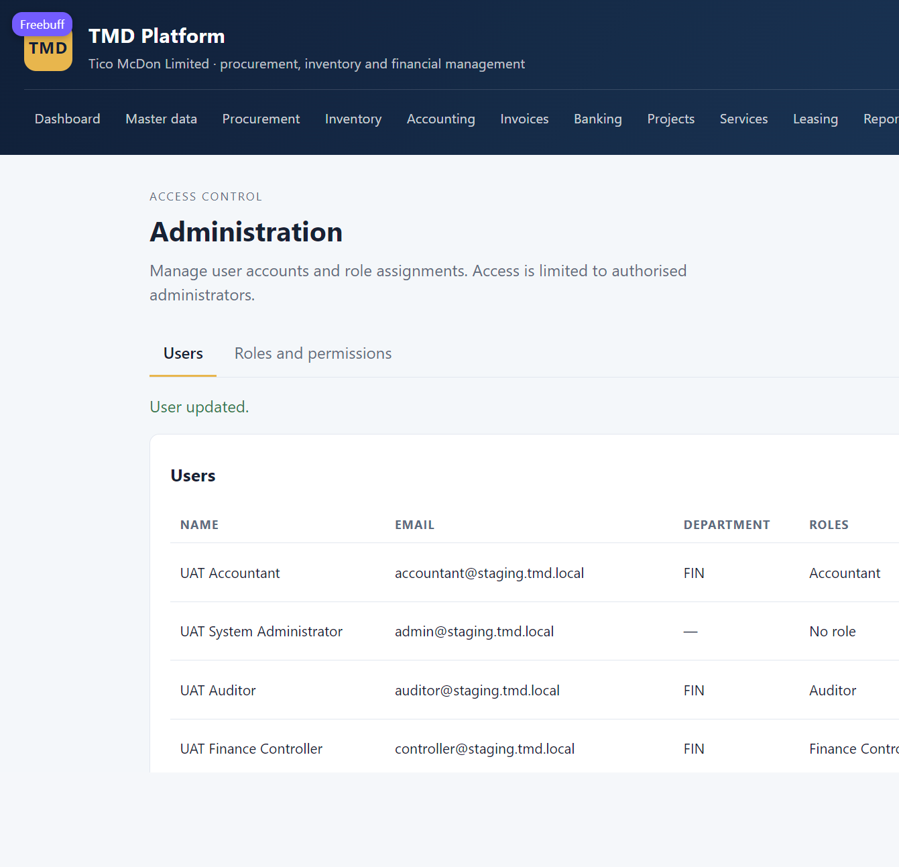
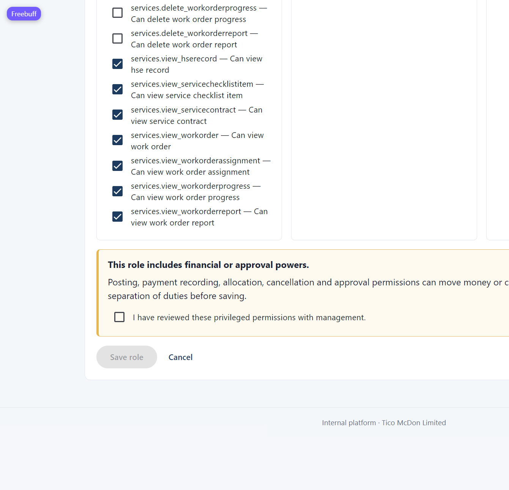

# Final UX and Accessibility Acceptance — 12 November 2026

**Decision:** Accepted for staging UAT. Not accepted for production until the business and financial
blockers in the final status report are closed.

## Administration browser workflows

Tested with a dedicated UAT access-administrator account (no superuser flag), confined to user and
role administration permissions.

The temporary UAT access-administrator and receipts accounts were deactivated after testing. No
password is recorded in this report.

| Workflow | Result |
| --- | --- |
| Open Users and Roles tabs as an authorised administrator | Pass |
| Create a user with a role, initial password and change-on-first-login flag | Pass |
| Deactivate a user and confirm the account becomes inactive | Pass |
| Reactivate the user and set a new password | Pass; new password verified |
| Assign and change roles | Pass; role list and member count retained |
| Role permission assignment | Pass |
| Privileged financial/approval permissions | UI marks 31 high-risk permissions, shows an explicit warning and disables **Save role** until acknowledged; the API also refuses an unacknowledged grant |
| Non-administrator access to Administration | Restricted state retained |

The protected grant rule is server-enforced. A role cannot add a permission beginning with `post_`,
`approve_`, `record_`, `allocate_` or `cancel_`, or `invoicing.manage_invoicesettings`, without
`acknowledge_privileged`. This does not remove the separate posting gate, independent-approver rule
or role separation.

## Responsive matrix

Measured from the live DOM at each viewport. The capture surface crops wide screenshots at 1366 px;
measurements, not the cropped image, determine acceptance.

| Viewport | Result |
| --- | --- |
| 1920 × 1080 | No page overflow; one H1; 4 dashboard metric columns; one navigation row |
| 1366 × 768 | No page overflow; one H1; 4 columns; one navigation row |
| 1024 × 768 | No page overflow; 3 columns; navigation wraps to two rows |
| 768 × 1024 | No page overflow; 2 columns; navigation wraps to two rows |
| 390 × 844 | No page overflow; 1 column; four navigation rows; table action column stays visible |
| 360 × 800 | No page overflow; 1 column; four navigation rows; table action column stays visible |

At 360 px the receipt table had a 254 px viewport with 1,017 px scroll width; the sticky action cell
remained fully visible at x 299. The page itself did not scroll horizontally.

## Fixes made in this pass

- Removed the duplicate page-level `<h1>`: the header brand is now a styled paragraph, leaving one
  H1 per page.
- Fixed navigation overflow by allowing the nav to shrink and wrap; all modules remain reachable at
  360, 390, 768, 1024, 1366 and 1920.
- Added wrap to Administration tabs.
- Added sticky action columns to Administration tables.
- Added visible gold focus outlines for links, buttons and navigation.
- Preserved the navy/gold palette and overall layout.

## Keyboard and semantics

- Tab from the header lands on **Sign out** with a 2 px visible outline.
- The next Tab reaches **Dashboard** with the same outline.
- Dialogs move focus to the first control; destructive confirmations disable submission until a
  required reason is entered.
- Tables expose captions and column headers; forms use labels; status notices use `role="status"`
  and errors `role="alert"`.
- Action buttons have accessible names; icon-free labels avoid ambiguity.

The receipt creation dialog was completed by keyboard/accessible controls. The mobile receipt table
was scrolled horizontally while the action column remained fixed.

## Evidence

- [Dashboard at 1366](evidence/final/dashboard-1366-final.png)
- [Dashboard at 390](evidence/final/dashboard-390.png)
- [Receipts at 1366](evidence/final/customer-receipts-list-1366.png)
- [Receipts at 360](evidence/final/customer-receipts-360.png)

## Limitations

- No automated axe, Lighthouse or screen-reader session was run. Semantics were inspected through
  the accessibility tree and DOM, which is not a substitute for NVDA/JAWS/VoiceOver testing.
- Screenshot capture is capped by the local preview surface, so wide screenshots are cropped even
  when the DOM reports no overflow.
- PDF viewer content could not be visually captured; PDF validity was verified by API tests.
- Touch target size was not audited against WCAG 2.5.8 on every control.
- Native date input presentation differs between browsers.
