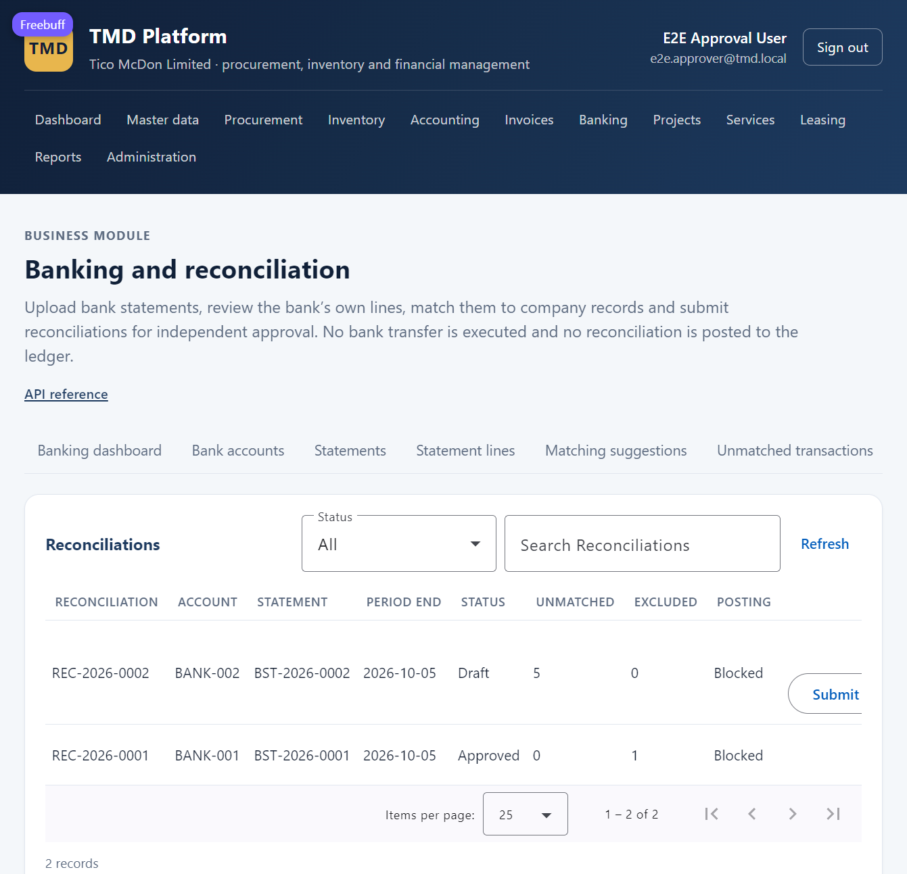

# Phase 8 completion report — Banking and reconciliation

**Date:** 12 November 2026
**Stage:** Phase 8 — development and testing only
**Status:** Implemented, browser-reviewed and tested; **not authorised for production bank execution, reconciliation posting or ledger entry**

## 1. Scope completed

Phase 8 adds a banking application that records the company's own bank activity, imports the bank's statements, supports controlled matching and reconciliation, and exposes the results in the Angular portal. It does not connect to a bank, move money or post a journal.

The completed capability is:

- company bank account register, including currency, account classification and last-four reference;
- CSV and XLSX statement import with custom column mapping, opening/closing balances and file checksum;
- statement lines, duplicate-line detection and duplicate-import rejection;
- company bank transactions, including transactions created from recorded supplier payments;
- matching suggestions, one-to-one, one-to-many, many-to-one and manual matches, partial matching, splits and unmatching;
- excluding a statement line with an investigation note;
- reconciliations with preparation, submission, independent approval and rejection;
- reconciliation report computed from live lines and confirmed matches;
- petty cash accounts, cash vouchers, replenishments and internal account transfers;
- banking dashboard, unmatched transactions and cash position reports;
- permission checks, audit events, pagination, filters and report tabs in the Angular workspace.

## 2. Completion matrix

| Requirement | Backend | Angular portal | Controls | Tests | Status |
|---|---|---|---|---|---|
| Company bank account register | `BankAccount` model and API at `/api/v1/company-bank-accounts/` | Bank accounts tab with account code, bank, last four, classification and status | Separate route from supplier bank accounts; no ledger mapping invented | Included | Complete |
| CSV statement import | Parser with aliases for date, description, reference, debit, credit and amount; explicit column mapping and date formats | Upload action with file and statement details | Rejects unsupported files, empty statements and invalid amounts/dates | Included | Complete |
| XLSX statement import | `openpyxl` read-only parser using the active sheet | Same upload action; `.xlsx` accepted | No macros or external links executed | Included | Complete |
| Duplicate statement file | SHA-256 checksum per bank account | API error shown in upload dialog | Exact re-import of the same file is rejected | Included | Complete |
| Duplicate statement line | Fingerprint plus amount/date/description/reference comparison within the account and a ±7-day window | Duplicate status and duplicate reference on statement lines | Duplicate is flagged, not silently deleted; user decides whether to exclude it | Included | Complete for the fresh import; see limitation 3 |
| Matching suggestions | Signed-amount, date-window and reference/description scoring; suggestions are advisory | Matching suggestions tab | A suggestion never becomes a match until a user confirms it | Included | Complete |
| One-to-one, one-to-many and many-to-one matching | `ReconciliationMatch` supports `one_to_one`, `one_to_many`, `many_to_one` and `manual`; remaining amounts enforce partial matches | Split-match action on a statement line | Match cannot cross bank accounts, currencies or receipt/payment direction; cannot exceed remaining line or transaction value | Included | Complete |
| Manual override and unmatch | Match type `manual`; unmatch recalculates line and transaction status | Match and unmatch actions | Only draft or rejected reconciliations can change | Included | Complete |
| Bank charges, interest and unidentified items | Transaction classification and statement-line matching controls | Classification fields and match/exclude actions | Charges and interest can be matched as ordinary signed transactions; no automatic journal | Included | Complete as record-keeping |
| Excluded lines | `duplicate_status` and `excluded` line status with reason | Exclude action with investigation reason | Excluded lines remain visible and do not block submission, but are counted in the reconciliation report | Included | Complete |
| Submit reconciliation | Blocks unresolved lines; records submitter and time | Submit for approval action | A reconciliation with unmatched/partially matched lines cannot be submitted | Included | Complete |
| Independent approval | Approver permission; preparer cannot approve | Approve and reject actions permission-gated | Approval is a control decision only; `posting_status` remains `blocked` | Included | Complete |
| Reconciliation report | Live counts of matched, unmatched and excluded lines and confirmed match amounts | Report tab | No stored or invented balances | Included | Complete |
| Supplier-payment integration | Optional `company_bank_account` on `SupplierPayment`; creates an expected bank transaction when chosen | Supplier payment form exposes the company account | Recording does not execute a payment or assert that the bank has processed it | Included | Complete for Stage 7A recording |
| Petty cash and cash vouchers | Cash accounts, vouchers, submission, approval and recording states | Petty cash, cash vouchers and replenishments tabs | Approval and recording are separate; no cash ledger posting | Included | Complete |
| Internal transfers | Transfer record with from/to accounts, amount, status and audit | Account transfers tab | Transfer is recorded internally; no bank instruction or execution | Included | Complete |
| Audit and permissions | Hash-chained audit events and module permissions for every write action | Actions hidden when permission is absent | No delete route; reconciliation state transitions enforced server-side | Included | Complete |

## 3. APIs added

```
/api/v1/company-bank-accounts/              list, create, retrieve, update
/api/v1/bank-statements/                    list, create (multipart import), retrieve
/api/v1/statement-lines/                    list, retrieve
/api/v1/statement-lines/{id}/match/         POST — split or manual match
/api/v1/statement-lines/{id}/exclude/       POST — investigation reason
/api/v1/statement-lines/{id}/unmatch/       POST
/api/v1/bank-transactions/                  list, create, retrieve, update
/api/v1/banking-match-suggestions/          GET
/api/v1/banking-unmatched-transactions/     GET
/api/v1/reconciliations/                    list, create, retrieve
/api/v1/reconciliations/{id}/submit/        POST
/api/v1/reconciliations/{id}/approve/       POST
/api/v1/reconciliations/{id}/reject/        POST
/api/v1/banking-reconciliation-report/      GET
/api/v1/banking-summary/                    GET
/api/v1/banking-cash-position/              GET
/api/v1/bank-transfers/                     list, create, retrieve
/api/v1/cash-accounts/                      list, create, retrieve, update
/api/v1/cash-vouchers/                      list, create, retrieve
/api/v1/petty-cash-replenishments/          list, create, retrieve
```

## 4. Controls and deliberate constraints

- **No bank connection.** There is no bank API client, payment file upload, transfer instruction or execution endpoint.
- **No reconciliation posting.** Approval changes the control status only. `posting_status` is always `blocked` with the Stage 7B explanation.
- **No invented balances.** Opening and closing balances come from the imported statement; the cash position and dashboard are computed from recorded accounts and transactions.
- **No invented mappings.** Company bank accounts are not linked to ledger accounts. Account mapping is a Stage 7B finance decision.
- **Duplicate import protection.** The checksum is scoped to the bank account, so the same statement cannot be imported twice into one account.
- **Duplicate line protection.** A line is suspected when the same signed amount, normalised description/reference and date (within seven days) already exists for that account.
- **Direction and currency controls.** A receipt cannot match a payment; a line and transaction must belong to the same account and currency.
- **Remaining-value controls.** A match cannot exceed the unmatched amount on either side, which allows genuine partial and split matches without double-counting.
- **Submission gate.** Unresolved statement lines block submission.
- **Independent approval.** The preparer cannot approve the reconciliation. The tested second account, `e2e.approver@tmd.local`, approved `REC-2026-0001`.
- **Audit.** Account creation, statement import, transaction creation, matching, exclusion, submission, approval and rejection are audited. Audit events are append-only at the API layer; database-level append-only enforcement is not yet present.
- **Permissions.** Each mutation checks a named banking permission; the Angular action is hidden when the signed-in account lacks it.

## 5. Browser E2E evidence

The Phase 8 workflow was exercised in Chromium against Django/PostgreSQL and the running Angular dev server:

1. Created `BANK-001` — Main operating account, Zenith Bank, last four `1234`.
2. Imported the synthetic CSV statement `scripts/fixtures/bank-statement-2026-10.csv` with opening balance `500000.00` and closing balance `708700.00`.
3. The import produced `BST-2026-0001`, reconciliation `REC-2026-0001` and five statement lines.
4. Created expected company transactions `BTX-2026-0001` to `BTX-2026-0005`.
5. Matched the `150000.00` receipt one-to-one.
6. Matched the `90000.00` supplier payment as a split `40000.00 + 50000.00` (one-to-many).
7. Matched the `2500.00` bank charge and `1200.00` interest.
8. Excluded the duplicate `150000.00` line with an investigation reason.
9. Submitted the reconciliation; the four matched lines and one excluded line left zero unmatched lines.
10. The preparer's approval was refused: `A reconciliation cannot be approved by the person who prepared it.`
11. Signed in as the independent approver and approved `REC-2026-0001`; status became `Approved` and posting remained `Blocked`.
12. Opened the reconciliation report and confirmed four matched lines, zero unmatched, one excluded and posting blocked.
13. Created a second account `BANK-002` and imported a fresh statement. The fourth line was flagged `Suspected duplicate` against line 6, demonstrating intra-statement duplicate detection after the fix.



## 6. Verification

```
backend:      270 tests pass (14 banking, 21 projects, 5 services, 7 leasing, remaining existing modules)
ruff:         clean
Django check: no issues (1 silenced)
migrations:   banking 0001 and 0002, invoicing 0003 and 0004, documents 0003 applied; makemigrations --check clean
frontend:     production build succeeds; lint clean; 45 tests pass
browser:      Chromium workflow above against live APIs
```

The banking tests cover CSV and XLSX parsing, statement import, duplicate file and duplicate line detection, matching/splits/exclusions, submission blocking, independent approval and posting refusal, reconciliation report values, petty cash, replenishments and transfers. The live browser run verified the Angular rendering and action wiring, not only the API.

## 7. Limitations

1. **No production posting or bank execution.** This is intentional. Stage 7B controls are not authorised.
2. **No bank feed or payment rails.** Only file import is supported; there is no OFX, MT940, API feed or outbound transfer instruction.
3. **The original October statement was imported before the intra-statement duplicate fix.** Its fourth line still displays `Clear` in the existing rows. A fresh import showed the line as `Suspected duplicate`; the system does not retroactively rewrite an already approved reconciliation's line status.
4. **Matching suggestions are heuristic.** Scoring is advisory and does not learn from user decisions or provide a tolerance matrix by transaction type.
5. **Reconciliation approval is single-level in the exercised workflow.** It uses the shared approval engine and permission, but no separate threshold band was created for reconciliations because no approved banking approval policy was supplied.
6. **Bank-account-to-ledger mapping is absent.** No journal can be generated for charges, interest, transfers or reconciliations.
7. **Cash workflows are record-keeping only.** Vouchers and replenishments have no physical cash count, imprest policy or ledger posting.
8. **No saved report export.** Report tabs are live API views; there is no PDF/Excel export or scheduled reconciliation pack.
9. **Angular E2E is manual.** The browser workflow was driven through Chromium but no Playwright suite is committed. The tables use horizontal scrolling at narrower desktop widths, which clips rightmost action columns in screenshots.
10. **Document attachments are not exposed on banking records.** Private documents can be linked through the generic document API, but there is no banking attachment action.

## 8. Stage 7B gate

Phase 8 does not cross the Stage 7B activation gate. Production financial posting, reconciliation approval posting, bank execution and NRS remain blocked until the missing Finance Controller, approved ledger mappings, posting rules, tax policy, opening balances, legal details and NRS credentials are supplied and authorised. See [`phase-7b-activation-blockers.md`](phase-7b-activation-blockers.md).
