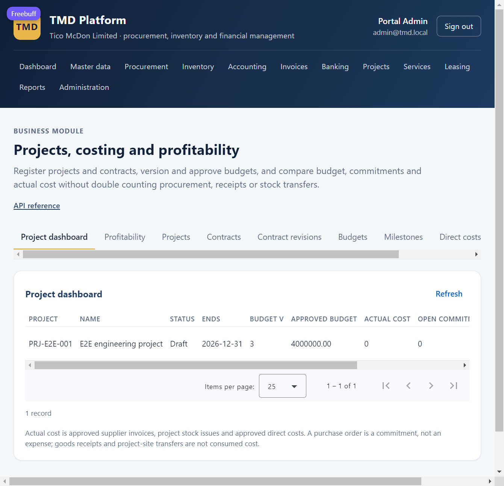
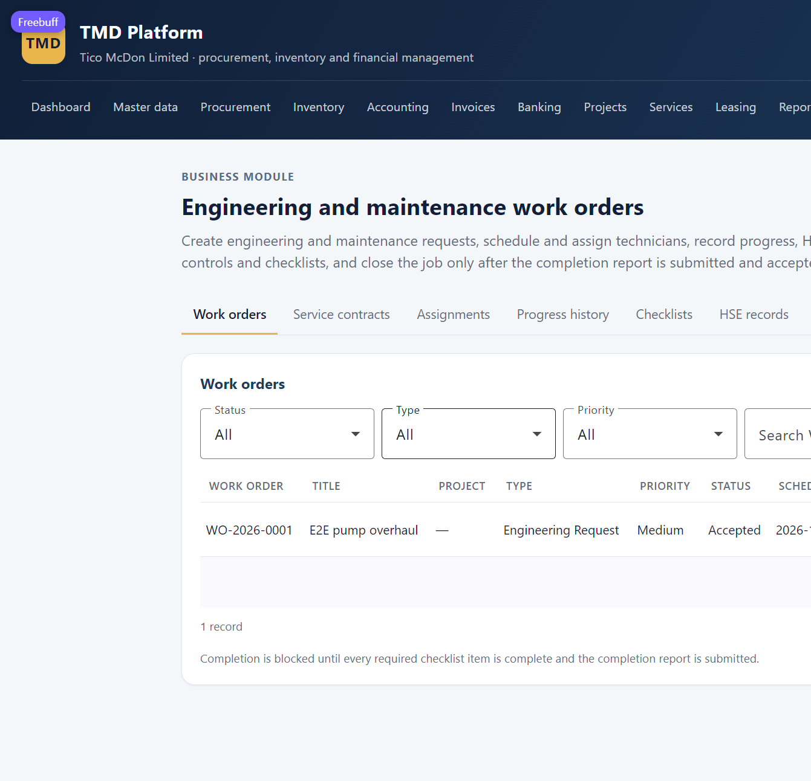
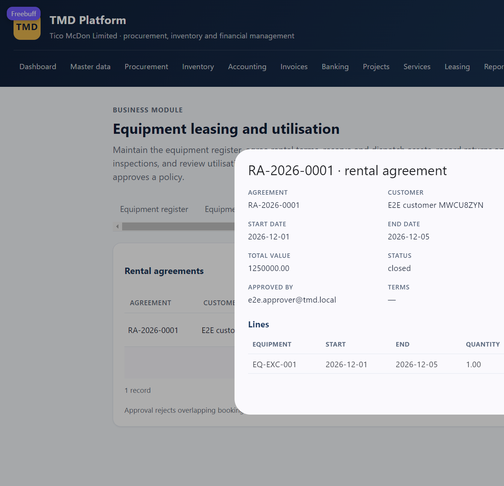

# Phase 9 completion report — Projects, services and equipment leasing

**Date:** 12 November 2026
**Stage:** Phase 9 — development and testing only
**Status:** Implemented, browser-reviewed and tested; **no revenue recognition, lease accounting or financial posting is authorised**

## 1. Scope completed

Phase 9 extends the existing platform with three connected operational areas:

1. **Projects and costing** — project register, assignments, locations, customer contracts, append-only contract revisions, versioned budgets, milestones, direct costs, procurement commitments, project material issues, profitability, dashboard and project documents.
2. **Engineering services** — service contracts, work orders, scheduling, assignments, progress, checklists, HSE records, completion reports, independent report review and customer acceptance.
3. **Equipment leasing** — equipment categories and register, rental rates, rental agreements, reservations, availability, dispatch, returns, inspections, damage charges, maintenance, utilisation and operational warnings.

All three are connected to live Django APIs from the Angular workspace. No backend-only module was declared complete.

## 2. Completion matrix

### 2.1 Projects and costing

| Requirement | Backend | Angular portal | Controls | Tests | Status |
|---|---|---|---|---|---|
| Project register | `Project`, project manager, department, cost centre, dates, status transitions | Projects tab and create/edit forms | Status transitions validated server-side | Included | Complete |
| Project locations and assignments | `ProjectLocation` and project manager/department fields | Location tab, project fields | No free-text department or cost centre bypass | Included | Complete |
| Customer contracts | `CustomerContract` with customer, value, dates and active flag | Contracts and contract revisions tabs | Revisions are append-only; old values retained | Included | Complete |
| Versioned budgets | `ProjectBudget` and `BudgetLine`; categories; revision reason; version assigned server-side | Budgets tab with nested lines and approve action | Approved budget immutable; later change must be a new version; at least one line required | Included | Complete |
| Independent budget approval | Shared approval engine; creator cannot approve; configured high-value band requires two approvers | Approve budget action and pending message | No approval by creator; one person cannot decide twice; ₦5m band uses two approvals | Included | Complete |
| Milestones | `ProjectMilestone` with planned/actual dates and status | Milestones tab | No automatic revenue recognition or invoicing | Included | Complete |
| Direct project costs | `ProjectCost` with category, supplier, reference, source type, approval | Direct costs tab | Only approved costs enter actual cost; creator cannot approve | Included | Complete |
| Procurement commitments | Approved/issued/partially received/received purchase orders destined for the project | Dashboard commitment column and detail | Order value is a commitment, not actual cost; open commitment subtracts approved invoices linked to that order | Included | Complete |
| Project material issues | `StockMovement` of type `project_issue` | Dashboard actual-cost composition and detail | Warehouse transfers and goods receipts are not counted as consumed cost | Included | Complete |
| Actual cost and available budget | Actual = approved supplier invoices linked to project + project stock issues + approved direct costs | Dashboard actual, commitment, available budget | No double counting of PO, receipt or transfer; available budget subtracts actual and open commitment | Included | Complete |
| Profitability | Contract value vs actual cost and open commitment; revenue recognition remains unconfigured | Profitability tab | Report labels estimate and does not claim recognised revenue | Included | Complete as an estimate only |
| Project documents | Private `Document` plus `DocumentLink`; GET document list; POST attach action | Project documents tab and Attach document action | Files are private; download requires authentication; checksums and audit | Included | Complete |

### 2.2 Engineering services

| Requirement | Backend | Angular portal | Controls | Tests | Status |
|---|---|---|---|---|---|
| Service contracts | `ServiceContract` with customer, dates, value, scope, activation | Service contracts tab and activate action | Contract cannot be activated by its creator | Included | Complete |
| Work orders | `WorkOrder` with type, priority, site, supervisor, dates, HSE requirements, status | Work orders tab with filters and lifecycle actions | Allowed transitions enforced in workflows | Included | Complete |
| Scheduling and assignments | Schedule action; `WorkOrderAssignment` for people and roles | Schedule, Assign person and Assignments tab | Only scheduled work can start; assignment history retained | Included | Complete |
| Progress | Append-only `WorkOrderProgress` with percent, notes, labour hours and materials | Record progress action and Progress history tab | Progress cannot move backwards; only open work accepts progress | Included | Complete |
| Checklists | `ServiceChecklistItem`; required flag; completion state | Checklists tab with create and Mark complete | Required incomplete items block completion | Included | Complete |
| HSE records | `HseRecord` with kind, date, findings and action | HSE records tab | Records are operational evidence; no invented clearance or permit approval | Included | Complete |
| Completion report | `WorkOrderReport` with summary, findings, recommendations and completion date | Completion reports tab with submit and reject actions | Report must be submitted before work can be completed | Included | Complete |
| Completion gate | Required checklist complete **and** report submitted | Complete action returns a specific refusal if either is missing | Gate enforced in `complete_work_order`, not only in the UI | Included | Complete |
| Customer acceptance | Acceptance action requires a completed order, submitted report and named representative | Record acceptance action | Acceptance marks report accepted and records the representative | Included | Complete |
| Service documents | Private attachment action linked to the work order | Attach document action with title and file | Private download, checksum, audit and link | Included | Complete |

### 2.3 Equipment leasing

| Requirement | Backend | Angular portal | Controls | Tests | Status |
|---|---|---|---|---|---|
| Equipment categories and register | Category, code, name, specification, serial, ownership, location, status | Equipment register and categories tabs | **No default asset classification or accounting treatment**; both are optional configurable text | Included | Complete |
| Rental rates | Effective-dated rate with basis, amount and currency | Rental rates tab | No rate derived from asset cost or depreciation | Included | Complete |
| Rental agreements | Customer, project, dates, lines, quantity, rate, total and terms | Rental agreements tab with nested equipment lines | Total value calculated from lines; no invoice or revenue posting | Included | Complete |
| Independent agreement approval | Submit then independent approve; requester cannot approve | Submit and Approve actions | Overlapping approved/active bookings rejected; requester exclusion | Included | Complete |
| Reservations and availability | Tentative reservations; confirmation checks overlapping approved/active agreements | Reservations and Availability tabs | Tentative booking does not block; confirmation does | Included | Complete |
| Dispatch | Movement record, equipment status `rented`, location and condition | Dispatch equipment action | Only approved/active agreements dispatch; equipment must belong to agreement | Included | Complete |
| Return | Movement record, equipment status available or maintenance, location and condition | Return equipment action | Latest movement determines whether equipment is still out | Included; close-check defect fixed and regression-tested |
| Close agreement | Requires every dispatched item to have a later return | Close agreement action | Cannot close with an open dispatch | Included | Complete |
| Inspections and damage | Inspection record, condition, damage description and charge amount | Inspections and damage tab | Charge amount is recorded, not invoiced automatically | Included | Complete |
| Maintenance | Preventive/corrective maintenance with start and complete states | Maintenance tab | Completing maintenance returns equipment to available where appropriate | Included | Complete |
| Utilisation and warnings | Utilisation percentage, maintenance/overdue warnings, availability query | Utilisation, Operational warnings and Availability tabs | Reports computed from movements and dates; no fabricated utilisation | Included | Complete |
| Rental documents | Private attachment linked to the agreement | Attach document action | Private download, checksum, audit and link | Included | Complete |

## 3. APIs added

```
/api/v1/projects/                           list, create, retrieve, update
/api/v1/projects/{id}/attach/               POST — private document attachment
/api/v1/projects/{id}/documents/            GET — linked private documents
/api/v1/project-locations/                  list, create, retrieve, update
/api/v1/customer-contracts/                 list, create, retrieve, update
/api/v1/contract-revisions/                 list, create, retrieve
/api/v1/project-budgets/                    list, create, retrieve, update
/api/v1/project-budgets/{id}/approve/       POST
/api/v1/project-milestones/                 list, create, retrieve, update
/api/v1/project-costs/                      list, create, retrieve, update
/api/v1/project-costs/{id}/approve/         POST
/api/v1/project-costs/{id}/reject/          POST
/api/v1/project-dashboard/                  GET
/api/v1/project-profitability/              GET
/api/v1/project-documents/                  GET

/api/v1/service-contracts/                  list, create, retrieve, update
/api/v1/service-contracts/{id}/activate/    POST
/api/v1/work-orders/                        list, create, retrieve, update
/api/v1/work-orders/{id}/schedule/          POST
/api/v1/work-orders/{id}/start/             POST
/api/v1/work-orders/{id}/progress/          POST
/api/v1/work-orders/{id}/hold/              POST
/api/v1/work-orders/{id}/resume/            POST
/api/v1/work-orders/{id}/complete/          POST
/api/v1/work-orders/{id}/accept/            POST
/api/v1/work-orders/{id}/attach/            POST — private document attachment
/api/v1/work-order-assignments/             list, create, retrieve, update
/api/v1/work-order-progress/                read-only history
/api/v1/service-checklists/                 list, create, retrieve, update
/api/v1/service-checklists/{id}/complete/   POST
/api/v1/hse-records/                        list, create, retrieve, update
/api/v1/work-order-reports/                 list, create, retrieve, update
/api/v1/work-order-reports/{id}/submit/     POST
/api/v1/work-order-reports/{id}/reject/     POST

/api/v1/equipment-categories/               list, create, retrieve, update
/api/v1/equipment/                          list, create, retrieve, update
/api/v1/equipment-rates/                    list, create, retrieve, update
/api/v1/rental-agreements/                  list, create, retrieve, update
/api/v1/rental-agreements/{id}/submit/      POST
/api/v1/rental-agreements/{id}/approve/     POST
/api/v1/rental-agreements/{id}/dispatch/    POST
/api/v1/rental-agreements/{id}/return_equipment/ POST
/api/v1/rental-agreements/{id}/close/       POST
/api/v1/rental-agreements/{id}/attach/      POST — private document attachment
/api/v1/equipment-reservations/             list, create, retrieve, update
/api/v1/equipment-reservations/{id}/confirm/ POST
/api/v1/equipment-movements/                list, retrieve
/api/v1/equipment-inspections/              list, create, retrieve
/api/v1/equipment-maintenance/              list, create, retrieve
/api/v1/equipment-maintenance/{id}/start/   POST
/api/v1/equipment-maintenance/{id}/complete/ POST
/api/v1/equipment-utilisation/              GET
/api/v1/equipment-warnings/                 GET
/api/v1/equipment-availability/             GET
```

## 4. Costing controls (no double counting)

The dashboard and profitability calculations use these explicit rules:

- **Actual cost** = approved supplier invoices linked to the project + `project_issue` stock movements + approved `ProjectCost` rows.
- **Commitment total** = approved, issued, partially received or received purchase orders whose destination is the project.
- **Open commitment** = order value minus approved supplier invoices linked to that purchase order, floored at zero.
- **Available budget** = approved budget total minus actual cost minus open commitment.
- **Not cost:** a purchase order by itself, a goods receipt, a warehouse transfer or a project-site transfer. These are commitments, evidence of receipt or movement, not consumed cost.
- **Revenue recognition:** not configured. Profitability is an estimate using active contract value and is labelled accordingly; it does not create revenue, receivables or journals.

## 5. Controls implemented

- **Budget versioning and independence:** version is assigned by the server; approved budgets cannot be edited; a new version preserves the old one. The creator cannot approve.
- **Approval bands:** the configured ₦5,000,000 project-budget band requires two independent approvals. The UI now displays `Approval recorded (1 of 2)` instead of falsely claiming final approval when only one decision has been recorded.
- **Work-order completion gate:** required checklist items must be complete and the completion report submitted. The gate is enforced in the service workflow, so a direct API call cannot bypass it.
- **Customer acceptance:** only completed work with a submitted report can be accepted, and a named customer representative is mandatory.
- **Service contract activation:** the creator cannot activate their own contract.
- **Rental approval:** requester cannot approve; overlapping approved/active bookings are rejected. A tentative reservation does not block, but confirmation checks availability.
- **Rental dispatch and return:** agreement status, equipment membership and the latest movement are checked. Closing now uses the latest movement per equipment, including returns.
- **Asset classification:** equipment records have blank `asset_classification` and `accounting_treatment` fields with no default. The system does not decide whether owned equipment is inventory, a fixed asset or a lease.
- **Private documents:** project, work-order and rental-agreement attachments use the same authenticated document store, checksum, private flag and audit trail as the rest of the platform. There is no public media URL.
- **Permissions and audit:** each mutation checks a module permission and writes an audit event. The Angular action is hidden when the permission is absent.
- **No financial posting:** no project, service or leasing action creates a journal, supplier invoice, customer invoice or revenue entry.

## 6. Browser E2E evidence

The Phase 9 workflows were exercised in Chromium against the live Django/PostgreSQL backend and Angular server:

### Projects

1. Created `PRJ-E2E-001` — E2E engineering project, 10 January to 31 December 2026.
2. Created budget version 1 for `5000000.00` with revision reason “Original cost plan”.
3. Attempted to approve it as its creator; the server refused: `A budget cannot be approved by the person who raised it.`
4. Signed in as `e2e.approver@tmd.local` and approved the high-value budget. The UI correctly reported `Approval recorded (1 of 2). Another independent approver is required.`
5. Created version 3 for `4000000.00` with a value-engineering reason and approved it as the independent approver.
6. The project dashboard showed budget version 3, approved budget `4000000.00`, actual cost `0`, open commitments `0` and available budget `4000000.00`.
7. Confirmed the dashboard note that purchase orders are commitments, not expenses.



### Services

1. Created work order `WO-2026-0001` — E2E pump overhaul at Lagos terminal.
2. Scheduled it for 20–22 November 2026 and started work.
3. Attempted completion with no report; the server refused: `Submit the completion report before completing the work order.`
4. Created required checklist item “Isolate pump and verify zero energy” and marked it complete.
5. Created and submitted completion report “Pump overhaul completed, alignment verified, no leaks.”
6. Completed the work order; status became `Completed` with 100% progress.
7. Recorded customer acceptance for representative “Chukwuka Nwabueze”; status became `Accepted`.
8. Attached a private service report through the new Attach document action; the UI confirmed `Service document attached privately.`



### Equipment leasing

1. Created category `EQ-HEAVY` and equipment `EQ-EXC-001` — Hydraulic excavator, 20-tonne tracked, Lagos yard. Asset classification and accounting treatment were left blank.
2. Created a daily rental rate of `250000.00 NGN` effective 1 January 2026.
3. Created rental agreement `RA-2026-0001` for 1–5 December 2026 with one equipment line; calculated value `1250000.00`.
4. Submitted the agreement; self-approval was refused with `A rental agreement cannot be approved by its requester.`
5. Approved it as the independent approver; status became `Approved`.
6. Dispatched `EQ-EXC-001` on 1 December 2026; agreement became `Active` and equipment `rented`.
7. Returned the equipment on 5 December 2026 with condition `Good`.
8. The first close attempt was refused with `Return all dispatched equipment before closing.` This exposed a real defect: the close check looked only at dispatches and ignored the later return. The latest-movement query was corrected and a regression test added.
9. Closed the agreement after the fix; status became `Closed` and the equipment returned to available.



## 7. Verification

```
backend:      270 tests pass (21 project, 5 services, 7 leasing, 14 banking, remaining existing modules)
ruff:         clean
Django check: no issues (1 silenced)
migrations:   projects, services, leasing and documents migrations applied
              documents.0003 adds work-order and rental-agreement link types
              makemigrations --check: no changes detected
frontend:     production build succeeds; lint clean; 45 tests pass
browser:      Chromium workflows above against live APIs
```

New coverage includes project document attachment privacy and linking, project budget versioning and independent approval, project costing without double counting, service completion gate and report acceptance, equipment classification remaining blank, rental overlap refusal, dispatch/return/inspection/maintenance, utilisation and availability, and the new close-after-return regression test. Frontend tests include all four new module endpoints and the private attachment form.

## 8. Limitations

1. **No revenue recognition.** Profitability uses contract value and estimated cost; it does not recognise revenue, create receivables or post journals.
2. **No lease accounting.** There is no IFRS 16 / ASC 842 right-of-use asset, lease liability, depreciation schedule, residual value, discount rate or finance-income calculation. Asset classification and accounting treatment remain blank by design.
3. **No equipment depreciation or fixed-asset register integration.** The equipment register is operational, not a financial asset ledger.
4. **Project actual cost was not populated in the browser run.** The formulas and API tests cover approved project invoices, project stock issues and approved direct costs, but the acceptance project had no such transactions; its dashboard correctly showed zero actual cost.
5. **No service billing.** Work orders and contracts do not create customer invoices, retainers or revenue.
6. **No resource-capacity or skills scheduling.** Assignments record people and roles but do not optimise availability, travel time or certifications.
7. **HSE records are evidence, not a permit-to-work engine.** No HSE clearance workflow, signature, expiry or stop-work enforcement is implemented.
8. **Reservations were API-tested but not exercised through the browser.** The browser run covered agreement approval, dispatch, return and close; reservation confirmation and conversion are covered by backend tests.
9. **Attachments are action-only outside projects.** Work orders and rental agreements accept private attachments and link them, but their workspaces do not yet show a linked-document list tab. The project workspace has a read-only Project documents tab.
10. **No customer or technician portal.** The module is staff-facing; there is no external acceptance, notification or mobile field-service interface.
11. **Manual browser E2E.** No Playwright suite is committed. The Angular tables use horizontal scrolling at narrower desktop widths, so screenshots clip rightmost columns.
12. **No project cost export.** Dashboard and profitability are live API views; there is no PDF/Excel project cost pack.
13. **No portfolio-level project accounting.** Multi-currency, FX, inter-project allocations, overhead absorption and WIP accounting are not implemented.

## 9. Stage 7B gate

Phase 9 does not authorise production financial posting, revenue recognition, lease accounting or NRS. Those remain blocked until the missing Finance Controller, approved ledger mappings, posting rules, tax policy, opening balances, legal details, lease accounting policy and NRS credentials are supplied and authorised. See [`phase-7b-activation-blockers.md`](phase-7b-activation-blockers.md).
