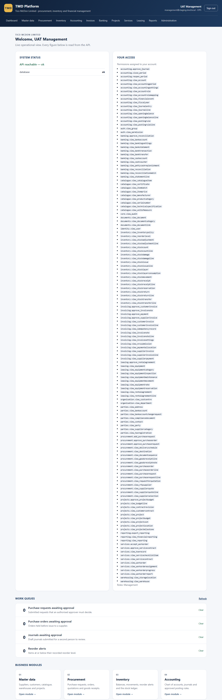
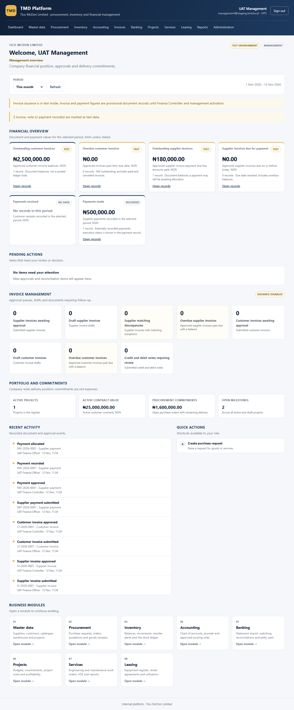
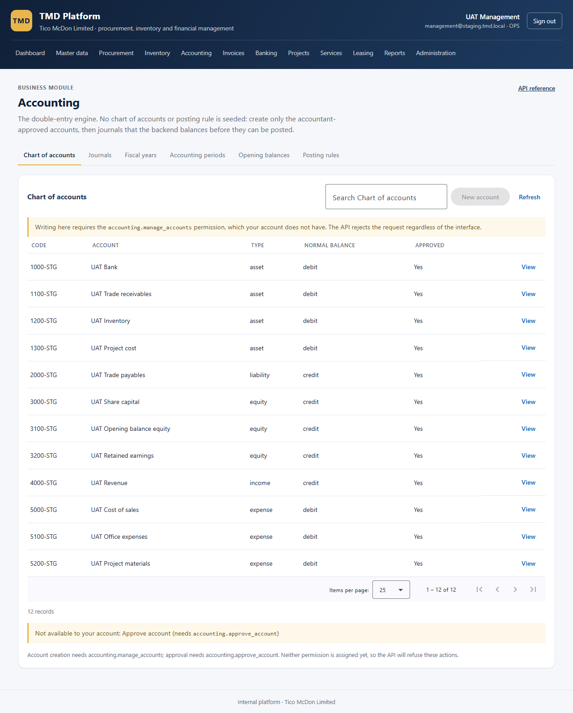
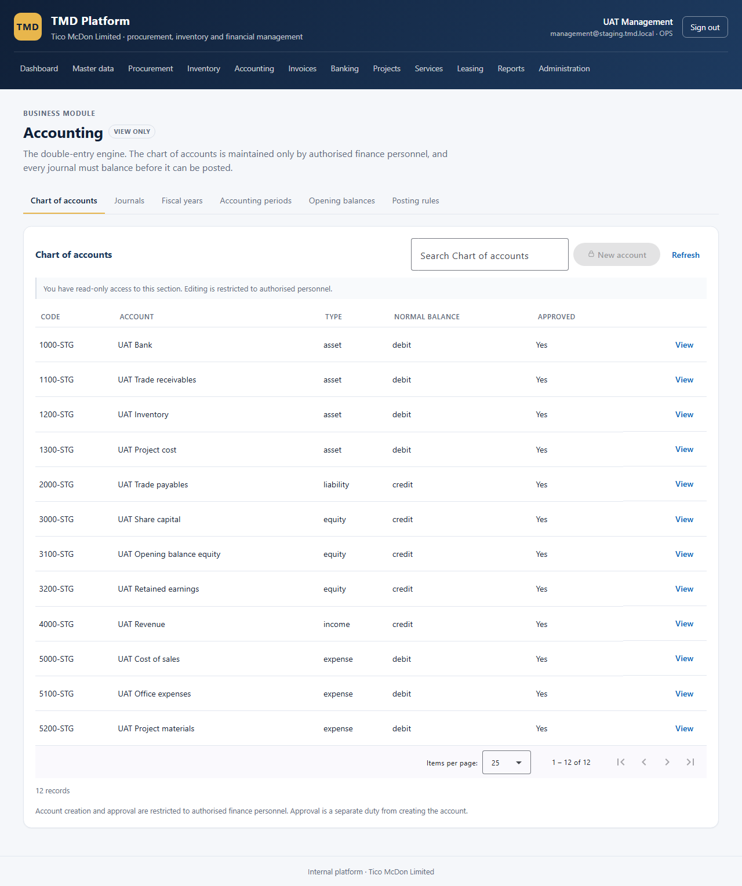
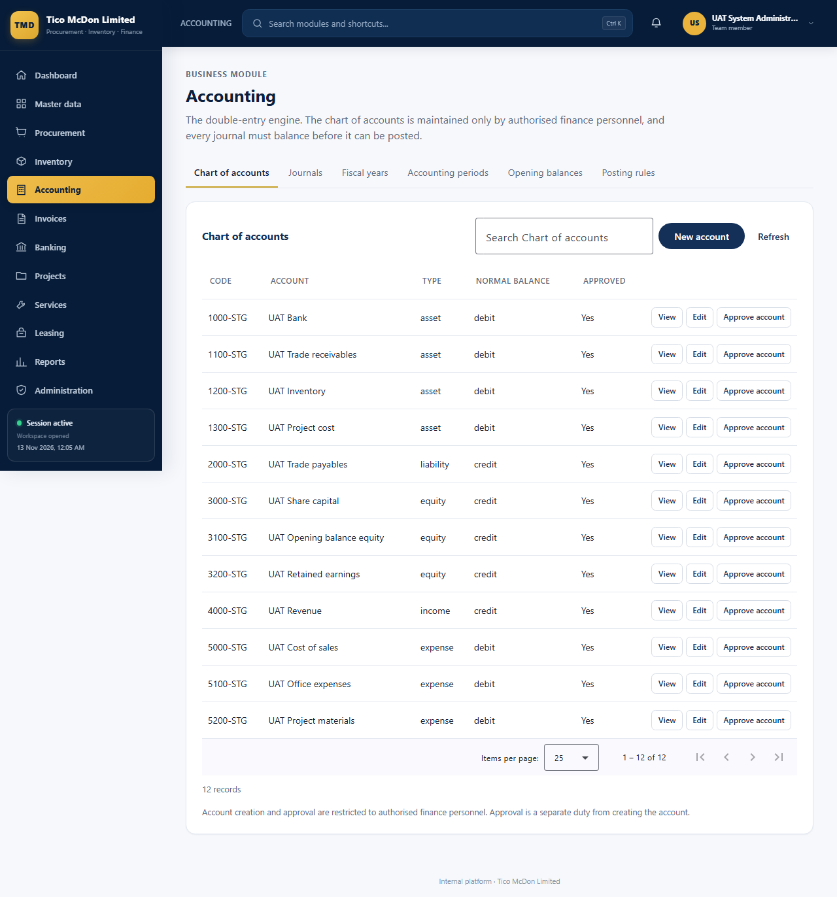
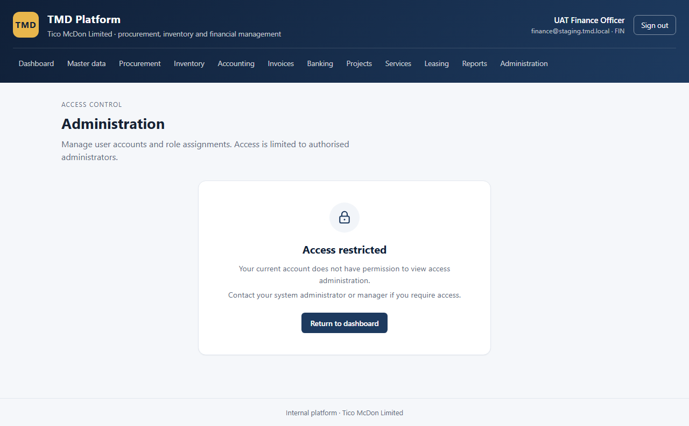
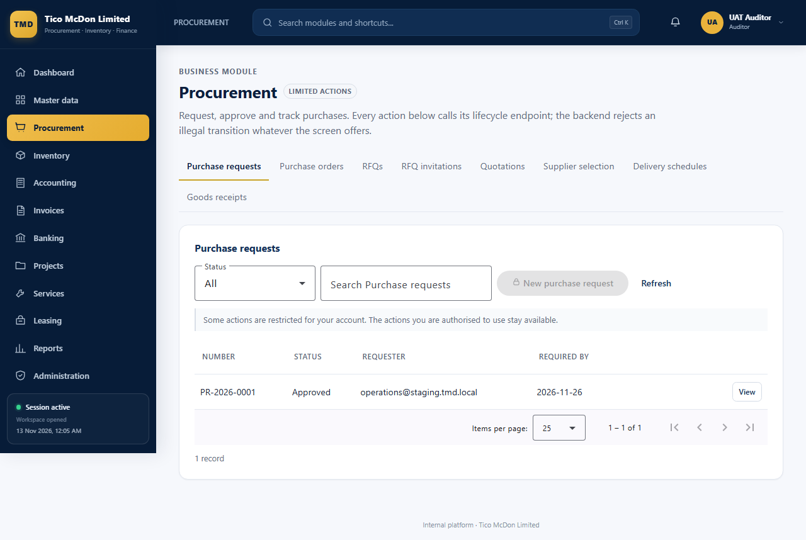

# TMD dashboard and access-experience report

**Date:** 12 November 2026
**Environment:** isolated `tmd_staging`, synthetic TMD employees and records
**Scope:** dashboard redesign, role-aware presentation, and consistent access states across the Angular portal
**Production activation:** none. No deployment, production finance activation, invoice issuance, payment execution or NRS submission was performed.

## 1. Outcome

The dashboard is now an operational landing page rather than a connectivity and permission dump. It shows only sections the signed-in employee may read, distinguishes document balances and recorded payments from posted ledger values, labels test-mode data, and links each summary to its source records.

The raw-permission warning on Accounting has been replaced by a compact **View only** state, a disabled creation control with a friendly tooltip, and a short read-only explanation. Pages the employee cannot read render a shared **Access restricted** state with no records and a return-to-dashboard action.

The existing navy, gold and neutral palette, product header, module navigation, typography and page structure are retained. The **API reference** link was removed from module and reporting headers because it served developers rather than operational employees and had no everyday business use for the signed-in user.

## 2. Before and after

### Management dashboard

| Before | After |
| --- | --- |
|  |  |

Before: API and database connectivity occupied the main panel, followed by a long list of technical permission identifiers. There was no financial, invoice, approval, activity or role context.

After: company financial position, pending actions, invoice queues, portfolio commitments, recent activity, authorised quick actions and period filters. API connectivity and permission identifiers are absent.

### Accounting read-only state

| Before | After |
| --- | --- |
|  |  |

Before: a large amber warning exposed `accounting.manage_accounts`, and a second warning exposed `accounting.approve_account`.

After: a small neutral **View only** badge, a lock icon on the disabled **New account** control, a tooltip explaining the restriction without a permission code, and a quiet read-only note. The 12-account table and permitted **View** actions remain available.

### Accounting authorised state

The System Administrator sees **New account**, **Edit** and **Approve account** controls enabled, with no read-only notice.

### Access-restricted page

The Finance Officer cannot read Administration. The page exposes no user or role records and provides **Return to dashboard**.

### Procurement limited-actions state

The Auditor can read procurement records and sees a **Limited actions** badge. **New purchase request** is disabled with a friendly tooltip, and the purchase-request table remains available.

## 3. Dashboard content and data provenance

### Financial overview

Cards cover outstanding customer invoices, overdue customer invoices, outstanding supplier invoices, supplier invoices due for payment, payments received and payments made. Amounts are in NGN.

- Customer and supplier balances use approved invoice document balances, not a posted ledger total.
- Payments received use recorded or reconciled customer receipts in the selected period.
- Payments made use recorded supplier payments in the selected period.
- A missing source set renders **No records in this period** and no synthetic zero.
- Test invoices and payments carry a **Test** state; the header carries **Test environment**.
- The financial section is omitted without `reporting.view_financialreporting`.

### Invoice management, pending actions and activity

Invoice queues cover submitted supplier and customer invoices, drafts, matching discrepancies, overdue documents and submitted credit/debit notes. Pending actions are built from actual authorised workflow queues and are hidden when their count is zero.

Recent activity is read from `AuditEvent`. It is limited to eight de-duplicated events and scoped to the active role focus, so a procurement or warehouse dashboard does not surface finance activity merely because the role holds a broad view permission.

### Period filters

The dashboard supports **This month**, **Last month** and a custom date range. The selected period is shown beside the filter. Invalid custom ranges are rejected in the browser and by the API.

### Role examples

| Role | Focus shown | Evidence |
| --- | --- | --- |
| Management | Company financial position, approvals, portfolio, commitments and activity | [Management](evidence/uiux/improved-dashboard-management.png) |
| Finance | Receivables, payables, payments, invoice queues and treasury | [Finance](evidence/uiux/dashboard-finance.png) |
| Procurement | Open orders, outstanding deliveries, RFQs and quotations; procurement-only activity | [Procurement](evidence/uiux/dashboard-procurement.png) |
| Warehouse | Stock value, low-stock alerts, transfers and goods receipts; stock-only activity | [Warehouse](evidence/uiux/dashboard-warehouse.png) |
| Project Manager | Assigned projects, approved budget, actual cost and milestones | [Project](evidence/uiux/dashboard-project.png) |

Observed staging values during review:

- Management and Finance: customer outstanding ₦2,500,000.00; supplier outstanding ₦180,000.00; payments made ₦500,000.00; payments received unavailable because no customer receipt exists in the period.
- Management portfolio: 1 active project; ₦25,000,000.00 active contract value; ₦1,600,000.00 procurement commitments; 2 open milestones.
- Procurement: 1 open purchase order; 2 outstanding deliveries; 1 open RFQ; 1 supplier quotation.
- Warehouse: stock value ₦1,315,000.00; 0 low-stock alerts; 0 transfer dispatches; 1 goods receipt.
- Project Manager: 1 assigned project; ₦12,000,000.00 approved budget; ₦540,000.00 actual cost; 2 open milestones.
- Three invoice, note or payment records are marked as test data.

These are staging observations, not production company figures.

## 4. Access-presentation rules

| Situation | Presentation |
| --- | --- |
| Page view allowed, editing denied | **View only** badge, records retained, disabled creation control with lock and friendly tooltip, quiet read-only note |
| Page view allowed, only some actions denied | **Limited actions** badge, permitted actions retained, denied actions disabled with friendly explanation |
| Page view denied | Shared **Access restricted** card, lock illustration, no records, administrator guidance and return-to-dashboard button |
| Approval denied but transaction visible | Transaction and status remain visible; approval controls are disabled or omitted; no permission code is shown |

The shared component is used by Workspace, Reports and Administration. Workspace pages cover Master Data, Procurement, Inventory, Accounting, Invoices, Banking, Projects, Services and Leasing. Reporting and Administration use the same access presentation.

Backend enforcement is unchanged: Django permission classes and workflow services remain the authority. Disabled or hidden Angular controls are presentation only.

## 5. Verification

| Check | Result |
| --- | --- |
| Backend reporting tests | **26 passed** |
| Frontend unit tests | **52 passed** |
| Frontend lint | **Passed** |
| Frontend production build | **Passed**; dashboard stylesheet is 7.99 kB, above the 6 kB warning budget but below the 8 kB error threshold |
| Browser role review | **5 Playwright tests passed**, covering Management, Finance, Procurement, Warehouse, Project Manager, Auditor and System Administrator |
| Original and improved screenshots | Captured in `docs/reports/evidence/uiux/` and reviewed in the browser |

Browser checks confirmed:

- no API connectivity or raw permission identifiers on the dashboard;
- financial sections are absent for Procurement, Warehouse and Project Manager;
- Finance activity does not appear on Procurement or Warehouse dashboards;
- quick actions are limited to actions the API permits for that account;
- Accounting read-only and account-management states differ as intended;
- restricted Administration exposes no table;
- the Auditor keeps read access to procurement while creation is disabled.

## 6. Limitations

- The review ran on synthetic staging data. Production financial activation remains disabled, so no production figures exist to display.
- No approval, rejection or payment was executed during this visual review; the dashboard and access states were inspected, not every workflow transition.
- The access presentation was verified on the modules listed above, with full role samples for Management, Finance, Procurement, Warehouse, Project Manager, Auditor and System Administrator. Other individual role combinations should still be checked during supervised UAT.
- This work does not change the production-readiness conclusion. MFA, TLS, off-host backup, monitoring, approved finance policy and management sign-off remain outstanding.

## 7. Follow-up — 12 November 2026

The dashboard module grid was completed to cover all eleven modules, including Invoices,
Reports and Administration. Each module now carries a role-aware **Restricted** badge when
the signed-in account lacks its view permission. Restricted modules stay visible with
**View access status** rather than disappearing, so an employee can see that the module
exists and who to ask without being shown its records.

The indicator comes from the dashboard API's `module_access` data, which is computed from
real view permissions. It is a presentation aid only; Django permission classes remain the
authority.

Additional browser evidence:

| State | Evidence |
| --- | --- |
| Finance Controller — Administration marked Restricted | [`evidence/uiux/dashboard-module-access-controller-bottom-2026-11-12.png`](evidence/uiux/dashboard-module-access-controller-bottom-2026-11-12.png) |
| Finance Controller — restricted Administration page | [`evidence/uiux/access-restricted-controller-2026-11-12.png`](evidence/uiux/access-restricted-controller-2026-11-12.png) |
| Recorded test payment — posting refused in test mode | [`evidence/uiux/payment-post-blocked-test-mode-2026-11-12.png`](evidence/uiux/payment-post-blocked-test-mode-2026-11-12.png) |
| Finance Controller dashboard header and financial overview | [`evidence/uiux/dashboard-controller-module-access-2026-11-12.png`](evidence/uiux/dashboard-controller-module-access-2026-11-12.png) |

The dashboard stylesheet remains at 7.99 kB: below the 8 kB error budget, above the 6 kB
warning budget. No budget was increased and no warning was suppressed.

Verification after the follow-up: 316 backend tests, 66 focused invoicing/reporting tests,
53 frontend tests, frontend lint and production build. The successful supplier-payment
posting path is covered by an automated test; the browser deliberately exercised only the
test-mode refusal because staging remains unactivated.
