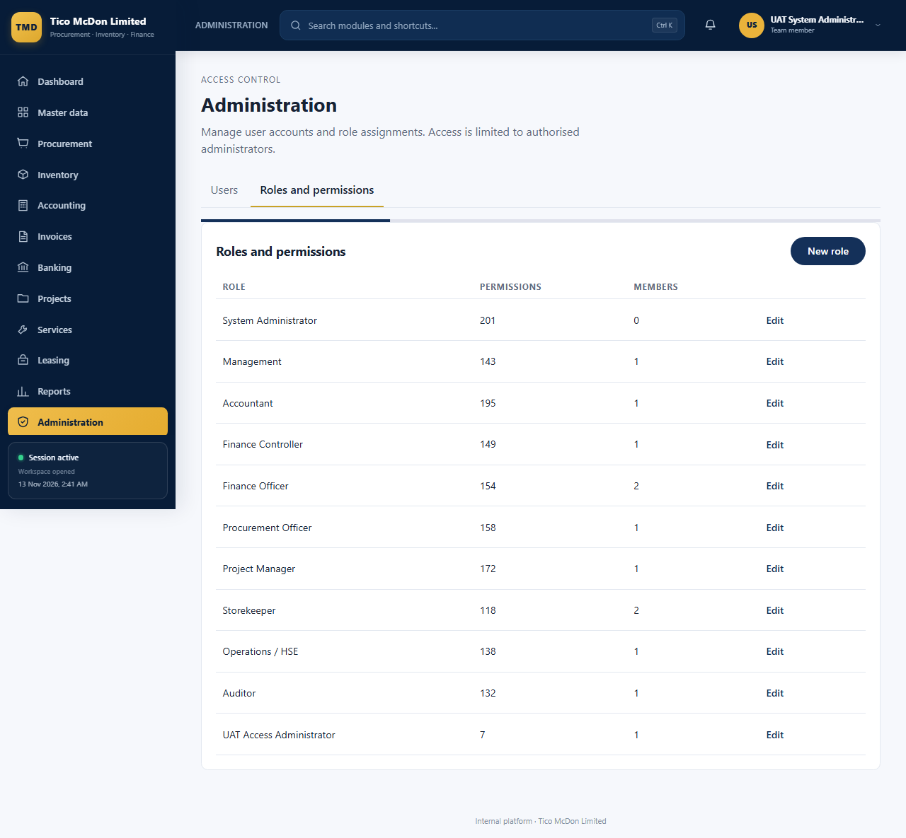
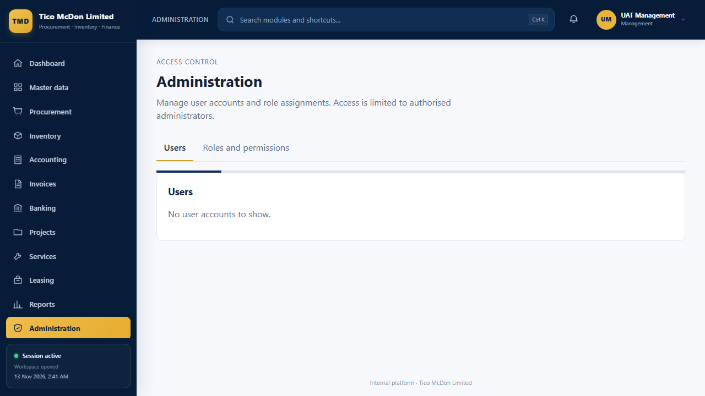
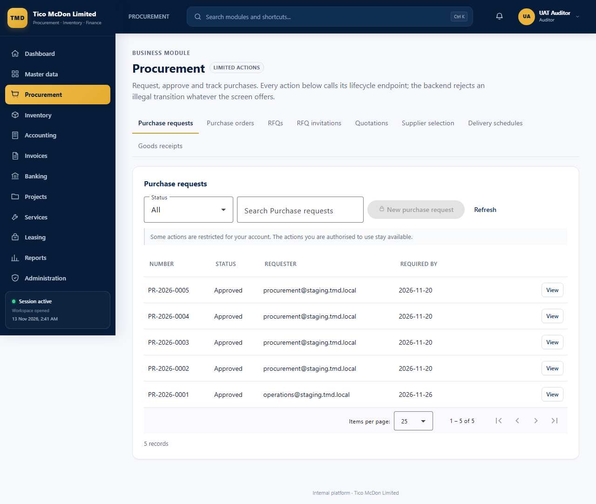

# Administration and Audit User Acceptance Test Script

**System:** TMD Enterprise System  
**Business areas:** Access administration, role governance, audit independence and controlled migration readiness  
**Primary roles:** System Administrator, Management (read-only administration), Auditor (read-only administration)  
**UAT cycle:** 13 November 2026  
**Environment:** Isolated QA database `tmd_qa_adversarial_20261113`  
**Data:** Ten synthetic role accounts; no company user records  
**Technical execution:** Complete for the cases below  
**Formal acceptance:** **PENDING** Administration, Management and Audit sign-off

## 1. Objective

Confirm that the System Administrator can maintain users and roles; that Management and the Auditor can inspect access configuration without mutation rights; that the ten-role provisional matrix is accurately represented; and that audit access remains independent and read-only.

## 2. Preconditions

- `role_matrix.py` has been applied to the QA database.
- The ten synthetic accounts exist and can authenticate.
- Management and Auditor have `view_user`, `view_group` and `view_permission` only.
- No user, role or permission is changed by this UAT script.

## 3. Administration test script and results

| ID | Business workflow / steps | Expected result | Actual result | Status | Evidence |
|---|---|---|---|---|---|
| ADM-01 | Sign in as System Administrator. Open Administration. | Users and Roles tabs are available; create-role and user-management controls are present. | Administration loaded; Users tab and “New user” visible. Roles tab showed “Roles and permissions” and “New role”. | **PASS** | `evidence/screenshots/administration-01-users-and-roles.png` |
| ADM-02 | Review the ten role accounts and their permission counts. | Exactly ten application roles are present; each account has the expected role. | Ten roles loaded; permission counts: System Administrator 623, Management 142, Accountant 194, Finance Controller 148, Finance Officer 154, Procurement Officer 158, Project Manager 172, Storekeeper 118, Operations/HSE 138, Auditor 132. | **PASS** | `evidence/uat-api-probe.json`; `docs/reports/evidence/role-access-matrix.md` |
| ADM-03 | Sign in as Management. Open Administration. | Users and roles are readable; no create/edit control is offered; direct write returns 403. | Users rendered without “New user” or “Edit”; `GET` users/roles 200; `POST /access/users/` 403. | **PASS** | `evidence/screenshots/management-04-administration-read-only.png`; `evidence/uat-api-probe.json` |
| ADM-04 | Sign in as Auditor. Open Administration. | Users and roles are readable; no mutation is possible. | Auditor could read users; “New user” and “Edit” absent; `POST /access/users/` 403. | **PASS** | `evidence/screenshots/audit-02-administration-read-only.png`; `evidence/uat-api-probe.json` |
| ADM-05 | Attempt to read access configuration as an operating role. | Operating roles cannot list users or roles. | Accountant, Controller, Finance Officer, Procurement, Project, Storekeeper and Operations all received 403 on `/access/users/` and `/access/roles/`. | **PASS** | `evidence/uat-api-probe.json` |
| ADM-06 | Create a new user and assign a role. | Only an authorised administrator can create a user; role assignment is auditable. | **NOT RUN** — no new synthetic user was needed; the control gap would not be exercised without a named joiner. Existing user/role management UI and permission enforcement were verified. | **NOT RUN — business witness required** | Administration component |
| ADM-07 | Change a role’s permissions. | A permission change is intentional, audited and independently reviewed. | **NOT RUN** — role changes require Management approval; none was authorised during this cycle. | **NOT RUN — approval boundary** | `backend/apps/core/role_matrix.py` |
| ADM-08 | Review MFA enforcement. | Privileged accounts require a second factor. | TOTP enrolment, challenge, recovery codes and per-user enforcement are implemented; production defaults global enforcement on. UAT accounts remain optional to preserve synthetic testing. | **PASS — implemented** | `evidence/uat-api-probe.json`; `backend/apps/identity/tests/test_mfa.py`; UAT-D-002 |
| ADM-09 | Review API throttling. | Login and API endpoints have an agreed abuse-control policy. | Axes 5 failures/1 hour; configurable general user/anonymous, login and MFA throttles; password reset 20/hour. | **PASS — implemented** | `evidence/uat-api-probe.json`; UAT-D-003 |
| ADM-10 | Review the General Requester decision. | Management confirms whether a separate Requester role is required. | There is no General Requester role. Operating roles can raise requests within their own role; Auditor is read-only. Decision not yet signed. | **PENDING management decision** | §5 |

## 4. Audit test script and results

| ID | Business workflow / steps | Expected result | Actual result | Status | Evidence |
|---|---|---|---|---|---|
| AUD-01 | Sign in as Auditor. Open Procurement. | Auditor can read the register but cannot create or approve. | Register showed `PR-2026-0002`; create control disabled; `POST /purchase-requests/` 403. | **PASS** | `evidence/screenshots/audit-01-procurement-read-only.png` |
| AUD-02 | Open Administration. | Read-only users/roles access, no writes. | Users/roles readable; no create/edit controls; write 403. | **PASS** | `evidence/screenshots/audit-02-administration-read-only.png` |
| AUD-03 | Open Reports and run a financial statement. | Auditor can independently inspect the posted ledger and statements. | `GET /reporting/financial-statements/` 200; Management report screenshot shows the statement. | **PASS** | `evidence/uat-api-probe.json`; `evidence/screenshots/management-03-financial-statements.png` |
| AUD-04 | Attempt to open Invoices, Banking and Administration as Auditor. | Read access is permitted only where granted; no hidden write path exists. | Auditor has read-only access to business records; financial report 200; no write endpoint offered. | **PASS** | `evidence/uat-api-probe.json` |
| AUD-05 | Confirm audit independence. | Auditor cannot approve a procurement request or change access. | Both write attempts returned 403. | **PASS** | `evidence/uat-api-probe.json` |

## 5. Role and permission sign-off matrix

### 5.1 Module access observed

✓ = view access; W = write/administration capability where granted; — = restricted.

| Role | Master data | Procurement | Inventory | Accounting | Invoices | Banking | Projects | Services | Leasing | Reports | Administration |
|---|---|---|---|---|---|---|---|---|---|---|---|
| System Administrator | W | ✓ | ✓ | ✓ | ✓ | ✓ | ✓ | ✓ | ✓ | ✓ | W |
| Management | ✓ | ✓ + approve | ✓ | ✓ | ✓ + approve | ✓ + approve | ✓ + approve | ✓ + accept | ✓ + approve | ✓ | read |
| Accountant | W | ✓ | ✓ | W | W | W | ✓ | ✓ | ✓ | ✓ | — |
| Finance Controller | W | ✓ | ✓ | W | W + approve | W + approve | ✓ | ✓ | ✓ | ✓ | — |
| Finance Officer | W | ✓ | ✓ | W | W | W | ✓ | ✓ | ✓ | ✓ | — |
| Procurement Officer | ✓ | W | ✓ | ✓ | ✓ | — | ✓ | ✓ | ✓ | role tabs | — |
| Project Manager | ✓ | ✓ | ✓ | ✓ | ✓ | — | W | ✓ | ✓ | role tabs | — |
| Storekeeper | ✓ | ✓ | W | ✓ | ✓ | — | ✓ | ✓ | ✓ | role tabs | — |
| Operations / HSE | ✓ | ✓ | ✓ | ✓ | — | — | ✓ | W | ✓ | operational | — |
| Auditor | ✓ | read | ✓ | ✓ | ✓ | ✓ | ✓ | ✓ | ✓ | read | read |

`W` does not mean unrestricted deletion: delete is not granted in the provisional matrix. The authoritative codenames remain in `backend/apps/core/role_matrix.py`.

### 5.2 Role sign-off

| Role | Permission count | Can raise PR? | Admin read-only? | Business owner | Decision | Signature / date |
|---|---:|---|---|---|---|---|
| System Administrator | 623 | Yes | Write | ________________ | ☐ Approve ☐ Condition ☐ Reject | ____________ |
| Management | 142 | Yes | Yes | ________________ | ☐ Approve ☐ Condition ☐ Reject | ____________ |
| Accountant | 194 | Yes | No | ________________ | ☐ Approve ☐ Condition ☐ Reject | ____________ |
| Finance Controller | 148 | Yes | No | ________________ | ☐ Approve ☐ Condition ☐ Reject | ____________ |
| Finance Officer | 154 | Yes | No | ________________ | ☐ Approve ☐ Condition ☐ Reject | ____________ |
| Procurement Officer | 158 | Yes | No | ________________ | ☐ Approve ☐ Condition ☐ Reject | ____________ |
| Project Manager | 172 | Yes | No | ________________ | ☐ Approve ☐ Condition ☐ Reject | ____________ |
| Storekeeper | 118 | Yes | No | ________________ | ☐ Approve ☐ Condition ☐ Reject | ____________ |
| Operations / HSE | 138 | Yes | No | ________________ | ☐ Approve ☐ Condition ☐ Reject | ____________ |
| Auditor | 132 | No — read-only | Yes | ________________ | ☐ Approve ☐ Condition ☐ Reject | ____________ |

### 5.3 Management decision — no General Requester role

The matrix contains no separate **General Requester** role. This is intentional: every operating role can raise a purchase request within its existing role, while the Auditor remains read-only to preserve independence. Management must either:

- **Ratify** this design and confirm that requests are controlled by role plus approval band; or
- **Add** a General Requester role and a revised permission matrix before go-live.

**Decision: ____________________  Name: ____________________  Date: __________**

## 6. Controlled data migration plan (not executed)

No real company record has been imported. This is the controlled plan for a future, separately authorised migration.

### 6.1 Scope and sequencing

| Phase | Data | Control |
|---|---|---|
| 0. Authorise | Data owner, cutover date, rollback owner | Written Management approval; no migration without it |
| 1. Extract | Departments, cost centres, parties, catalogue, warehouses, chart of accounts, tax codes, opening balances, users/roles | Read-only extract; file hash and row counts recorded |
| 2. Clean | Duplicates, inactive parties, missing tax IDs, invalid units, unmapped accounts | Exception list signed by data owner; no silent guessing |
| 3. Stage | Import into an isolated staging database | No production connection; full backup before load |
| 4. Validate | Row counts, referential integrity, trial balance, control-account reconciliation | Every difference explained and signed |
| 5. Opening balances | As-of cutover date, one controlled journal | Finance Controller approval; no historical transaction replay |
| 6. Users and roles | Named users mapped to the ten-role matrix | No shared accounts; Auditor read-only; MFA decision applied |
| 7. Parallel run | Compare legacy and new balances/reports for an agreed period | Business sign-off on variances |
| 8. Cutover | Freeze legacy, final delta load, smoke test | Go/no-go decision; rollback snapshot retained |
| 9. Hypercare | Reconcile daily, log defects, freeze changes | Named support owner and exit criteria |

### 6.2 Mandatory reconciliation gates

- Debits equal credits in the opening trial balance.
- Accounts payable ledger equals migrated supplier balances.
- Accounts receivable ledger equals migrated customer balances.
- Inventory ledger equals opening stock valuation.
- Bank ledger equals the agreed cutover bank statement.
- Every migrated party, item, account and warehouse has a source-system identifier.
- No duplicate invoice, payment, receipt or journal is created.
- User counts and role assignments reconcile to the approved joiner/leaver list.

### 6.3 Rollback and stop conditions

Stop and roll back if any control total is unexplained, a required owner is unavailable, a source file fails its hash, a mapped account is ambiguous, or a production integration would be activated. The rollback is a database restore to the pre-load snapshot plus a documented incident record — never an ad-hoc deletion of migrated rows.

**Migration status: NOT STARTED. No real records imported.**

## 7. Defects and decisions

- UAT-D-001 fixed.
- UAT-D-002 MFA enforcement implemented; production defaults it on.
- UAT-D-003 API, login and MFA throttles implemented.
- UAT-D-004 role matrix and General Requester decision pending.
- Management/Auditor administrative access is intentional and read-only; it is **not** a defect.
- No role or user was changed during UAT.

## Visual evidence

## 8. Acceptance statement

> I confirm that the Administration and Audit controls above have been demonstrated and that I accept / accept with conditions / reject the access model and audit access.

| Field | Entry |
|---|---|
| Administration representative | ______________________________ |
| Management representative | ______________________________ |
| Audit representative | ______________________________ |
| Decision | ☐ Accept  ☐ Accept with conditions  ☐ Reject |
| Conditions / exceptions | ______________________________ |
| Signatures | ______________________________ |
| Date | ______________________________ |

**Current formal status: NOT ACCEPTED — business sign-off outstanding.**
