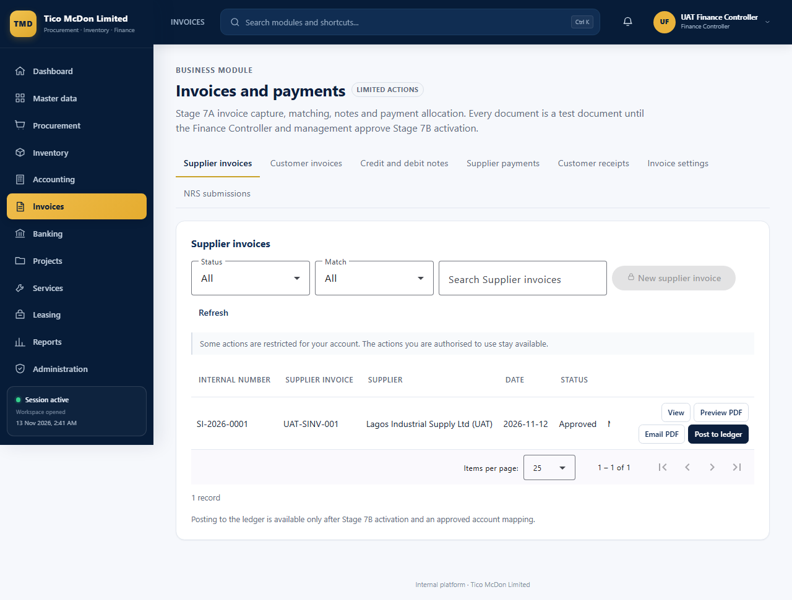
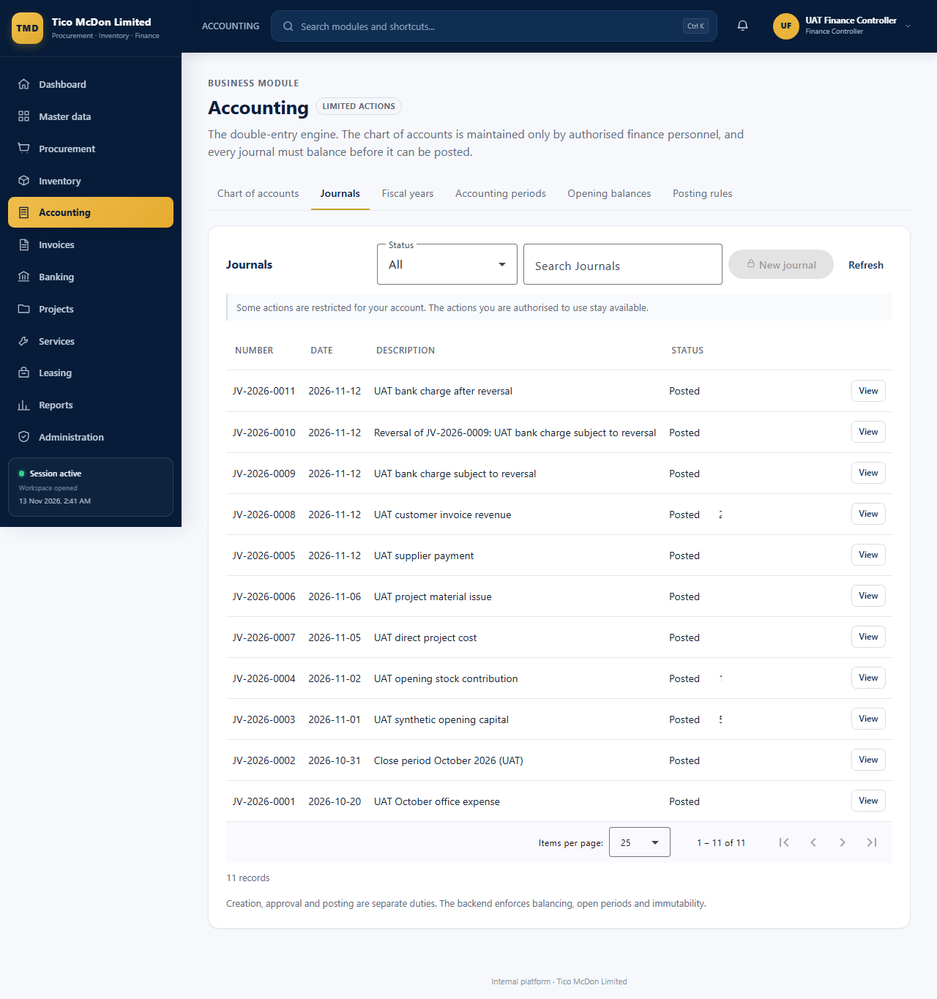

# Finance User Acceptance Test Script

**System:** TMD Enterprise System  
**Business areas:** Supplier invoices, customer invoices, payments, accounting, banking and reconciliations  
**Primary roles:** Finance Controller (lead), Accountant, Finance Officer  
**UAT cycle:** 13 November 2026  
**Environment:** Isolated QA database `tmd_qa_adversarial_20261113`  
**Data:** Synthetic UAT invoices, payments, journals, bank statement and reconciliation  
**Technical execution:** Complete for the cases below  
**Formal acceptance:** **PENDING** Finance Controller and Management sign-off

## 1. Objective

Confirm that Finance can review invoices, three-way matching, payment records, reconciliations, posted journals and financial statements; that the books reconcile; that Finance has no access to access administration; and that no production invoice, payment execution, NRS submission or new financial posting is activated.

## 2. Preconditions

- QA synthetic data includes `SI-2026-0001`, `CI-2026-0001`, `PAY-2026-0001`, `REC-2026-0001` and 11 posted journals.
- Finance Controller has invoice, banking and accounting view rights.
- Invoice test mode is on and NRS is disabled.
- No new journals or payments are posted by this UAT script.

## 3. Test script and results

| ID | Business workflow / steps | Expected result | Actual result | Status | Evidence |
|---|---|---|---|---|---|
| FIN-01 | Sign in as Finance Controller. Open Invoices. | Supplier invoices are visible with status, match status, total and test indicator. | `SI-2026-0001` rendered. QA data marks it `matched`; the invoice remains a test document. | **PASS** | `evidence/screenshots/finance-01-supplier-invoices.png` |
| FIN-02 | Review the supplier invoice match. | Invoice is matched to receipt/order within tolerance; payable is not posted twice. | Match status `matched`; AP ledger equals the supplier invoice balance in the synthetic reconciliation. | **PASS** | `docs/reports/evidence/staging-reconciliation.md` |
| FIN-03 | Review customer receivables. | Customer invoice `CI-2026-0001` has a visible balance and no production issuance. | QA records `CI-2026-0001` with balance `2500000.00`; invoice test mode remains on. | **PASS** | `docs/reports/evidence/workflow-checks.md` |
| FIN-04 | Open Banking → Reconciliations. | `REC-2026-0001` is approved and the bank ledger matches the statement closing balance. | Reconciliation visible as approved; bank ledger equals bank statement closing balance in the synthetic reconciliation. | **PASS** | `evidence/screenshots/finance-02-reconciliation.png`; `docs/reports/evidence/staging-reconciliation.md` |
| FIN-05 | Open Accounting → Journals. | Posted journals are visible and immutable; no draft journals are silently posted. | Journals tab loaded; `JV-2026-0011` visible; QA has 11 posted journals and the workflow evidence reports all journal sources posted. | **PASS** | `evidence/screenshots/finance-03-accounting.png` |
| FIN-06 | Run the financial statements for November 2026. | Statements are calculated from posted journals; balance sheet balances; net result is reported. | HTTP 200; statement view rendered; the seeded UAT evidence reports net result `2485000.00` and a balanced sheet. | **PASS** | `evidence/screenshots/management-03-financial-statements.png`; `docs/reports/evidence/staging-reconciliation.md` |
| FIN-07 | Review supplier payment status. | Payment is recorded for reconciliation but not executed by the system. | `PAY-2026-0001` is `recorded`; `execution_status` is `recorded`; no bank execution instruction exists. | **PASS** | `evidence/uat-api-probe.json` |
| FIN-08 | Attempt to open Administration as Finance Controller / Accountant. | Access is restricted; no access-management API is called. | Administration rendered “Access restricted”; direct `/access/users/` and `/access/roles/` returned 403 for Finance roles. | **PASS** | Role matrix; `evidence/uat-api-probe.json` |
| FIN-09 | Confirm production controls. | Invoice issuance, NRS and bank execution remain disabled. | `test_mode = true`, `can_issue = false`, `activated_at = null`, `nrs_enabled = false`; no NRS environment. | **PASS** | `evidence/uat-api-probe.json` |
| FIN-10 | Confirm no new financial posting occurred during UAT. | The controlled UAT workflow does not create a journal, invoice, payment or bank reconciliation. | Only the pre-existing synthetic posted journals exist; the new procurement approval created no financial record. | **PASS** | `evidence/uat-api-probe.json` |
| FIN-11 | Approve a new supplier invoice and post it to the ledger. | Authorised approver can post once; duplicate posting is blocked; audit trail is written. | **NOT RUN** — this would create a new financial posting, which is outside the authorised UAT boundary. Existing synthetic postings and automated tests were used as reference. | **NOT RUN — production control boundary** | Backend finance suite |
| FIN-12 | Execute a supplier payment through a bank. | The system must not execute a bank instruction; execution is recorded only. | Not run. The system has no bank-execution adapter and payment status is `recorded`; the business decision to enable execution is outstanding. | **NOT RUN — by design** | `evidence/uat-api-probe.json` |

## 4. Financial control results

| Control | Result |
|---|---|
| Trial balance | Balanced (debit = credit) in synthetic reconciliation |
| Balance sheet | Balanced |
| AP ledger vs supplier invoice | Equal |
| AR ledger vs customer invoice | Equal |
| Inventory ledger vs stock valuation | Equal |
| Bank ledger vs statement closing | Equal |
| Payment execution | Not performed; status recorded |
| Production invoice issuance | Disabled |
| NRS submission | Disabled |
| New journals posted during UAT | 0 |

## 5. Defects and conditions

- No Finance functional defect was found in the executed read-only cases.
- UAT-D-004 (role matrix) remains the open management decision. MFA and throttling are implemented; finance sign-off is still required for posting policy.
- Invoice posting and payment execution were deliberately not activated; this is a control boundary, not a test failure.
- The `/trial-balance/` endpoint returns HTTP 400 without required date parameters. This is input validation, not a permission defect; it was not counted as a UAT failure.

## Visual evidence

## 6. Acceptance statement

> I confirm that the Finance workflows above have been demonstrated and that I accept / accept with conditions / reject the Finance business area.

| Field | Entry |
|---|---|
| Business representative | ______________________________ |
| Position | ______________________________ |
| Decision | ☐ Accept  ☐ Accept with conditions  ☐ Reject |
| Conditions / exceptions | ______________________________ |
| Signature | ______________________________ |
| Date | ______________________________ |

**Current formal status: NOT ACCEPTED — business sign-off outstanding.**
