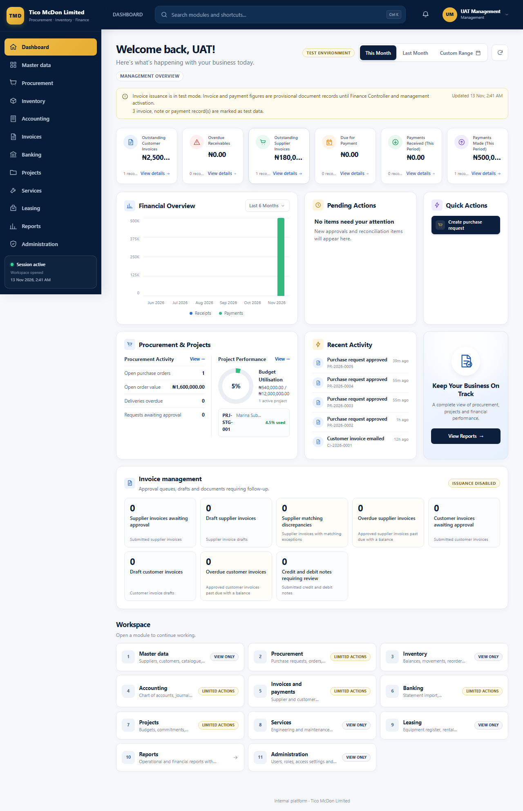
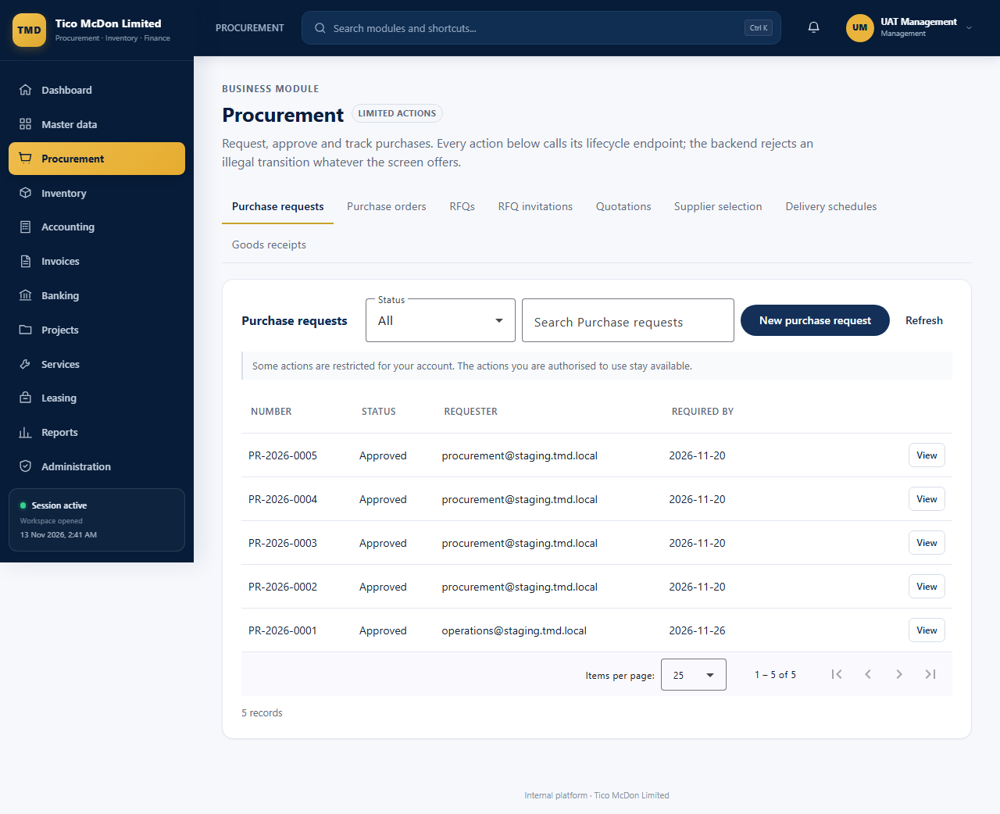
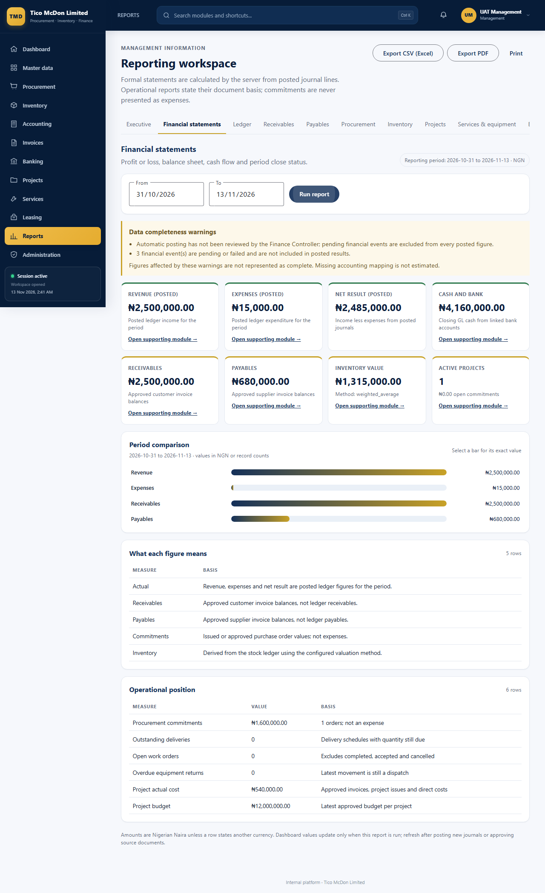
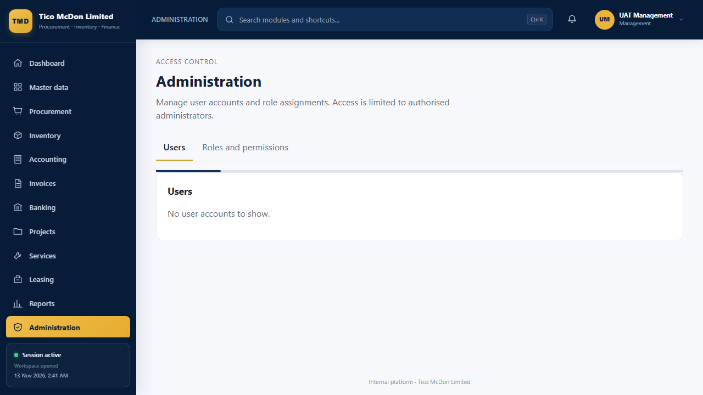

# Management User Acceptance Test Script

**System:** TMD Enterprise System  
**Business area:** Management oversight, approvals and management information  
**Primary role:** Management  
**UAT cycle:** 13 November 2026  
**Environment:** Isolated QA database `tmd_qa_adversarial_20261113`; frontend `http://127.0.0.1:49630`; API `http://127.0.0.1:8000`  
**Data:** Synthetic QA data only. No company records, production invoices, bank instructions or NRS submissions were used.  
**Technical execution:** Complete for the cases below  
**Formal acceptance:** **PENDING** named Management sign-off

## 1. Objective

Confirm that Management can oversee procurement, projects, inventory and finance; approve within delegated limits; run management reports; inspect access administration without changing it; and see that production issuance and external submission remain disabled.

## 2. Preconditions

- The QA database is seeded and the QA API/frontend are running.
- The Management test account has the role `Management`.
- No production integration is configured.
- Test records are labelled `UAT` in their business narrative.
- The tester has the approval authority described in the provisional role matrix.

## 3. Test script and results

| ID | Business workflow / steps | Expected result | Actual result | Status | Evidence |
|---|---|---|---|---|---|
| MGT-01 | Sign in as Management. Open the dashboard. Confirm the role focus and test-environment badge. | Dashboard loads with the Management focus; “Test environment” is visible; no production-issuance claim is made. | Dashboard showed “Welcome back”, the Management focus chip and the “Test environment” badge. | **PASS** | `evidence/screenshots/management-01-dashboard.png` |
| MGT-02 | Open Procurement. Find the controlled UAT request `PR-2026-0002`. Confirm requester, status and approver. | The request is visible as approved by Management; the requester is the Procurement Officer, not the approver. | `PR-2026-0002` displayed as approved. API evidence records `approved_by = management@staging.tmd.local`, requester `procurement@staging.tmd.local`. | **PASS** | `evidence/screenshots/management-02-procurement-oversight.png`; `evidence/uat-api-probe.json` |
| MGT-03 | Open Reports → Financial statements. Set the November 2026 period and run the report. | The report is computed server-side from posted journals, returns HTTP 200 and presents a balanced statement set. | The report request returned 200 and “Balance sheet” rendered. The QA ledger has 11 posted journals and the seeded reconciliation confirms the trial balance is balanced. | **PASS** | `evidence/screenshots/management-03-financial-statements.png`; `docs/reports/evidence/staging-reconciliation.md` |
| MGT-04 | Open Administration. Inspect Users and Roles. Attempt no change. | Management can read users and roles but cannot create or edit them. | Users rendered; “New user” and “Edit” were absent. API probe: `GET /access/users/` 200, `GET /access/roles/` 200, `POST /access/users/` 403. | **PASS** | `evidence/screenshots/management-04-administration-read-only.png`; `evidence/uat-api-probe.json` |
| MGT-05 | Confirm segregation of duties on the controlled procurement approval. | Requester and approver are different people; the approval is recorded once at the required band. | `approvals_required = 1`, `approvals_recorded = 1`, approver Management, requester Procurement. | **PASS** | `evidence/uat-api-probe.json` |
| MGT-06 | Confirm production safety gates from the invoice settings and payment records. | Invoice test mode is on; issuance is not activated; NRS is off; supplier payments are recorded but not executed. | `test_mode = true`, `can_issue = false`, `activated_at = null`, `nrs_enabled = false`; all supplier payments are `recorded`, execution status `recorded`. | **PASS** | `evidence/uat-api-probe.json` |
| MGT-07 | Review whether MFA is enforced for privileged accounts. | A privileged account must enrol and complete a second factor before a session is accepted. | TOTP enrolment, challenge, recovery codes and enforcement are implemented. Production defaults `MFA_REQUIRED_FOR_ALL_USERS=true`; UAT accounts remain optional so synthetic testing continues. | **PASS — implemented** | `evidence/uat-api-probe.json`; `backend/apps/identity/tests/test_mfa.py`; UAT-D-002 |
| MGT-08 | Review API protection against abusive request rates. | Login and authenticated APIs have an agreed rate limit or lockout policy. | Axes locks an account/IP combination after 5 failed logins for 1 hour. Configurable global authenticated/anonymous, login and MFA throttles are present; password reset remains 20/hour. | **PASS — implemented** | `evidence/uat-api-probe.json`; UAT-D-003 |
| MGT-09 | Review the ten-role matrix and confirm whether a separate General Requester role is required. | Management confirms or changes the provisional matrix, including the decision that operational employees raise requests within their existing roles. | Ten roles are configured. There is no General Requester role. All operating roles except Auditor can raise a purchase request; Auditor is intentionally read-only. **The matrix remains provisional until signed.** | **PENDING management decision** | `administration-uat.md` §5; `backend/apps/core/role_matrix.py` |

## 4. Workflow coverage

The controlled workflow executed for this UAT was:

`Procurement Officer creates PR-2026-0002 (draft) → submits → Management independently approves`

The workflow stopped at approval. No purchase order, goods receipt, supplier invoice, payment, journal, production invoice or bank instruction was created during this UAT cycle. The pre-existing synthetic chain `PR-2026-0001 → PO-2026-0001 → GRN-2026-0001 → SI-2026-0001` was inspected as reference evidence but was not re-executed.

## 5. Management policy decisions

The following items are not tester decisions. Management must approve, defer or reject each one before formal acceptance.

| Decision | Question for Management | Decision | Name / date |
|---|---|---|---|
| UAT-D-002 | MFA is implemented. Confirm production enforcement remains on and nominate the recovery administrator. | ☐ Confirm ☐ Amend ☐ Defer | ____________ |
| UAT-D-003 | Confirm the production throttle defaults or provide approved capacity-based rates. | ☐ Approve ☐ Amend ☐ Defer | ____________ |
| UAT-D-004 | Does Management ratify the ten-role matrix and the decision not to create a separate General Requester role? | ☐ Ratify ☐ Amend ☐ Reject | ____________ |

**No policy decision is recorded as approved by this UAT report.**

## 6. Defects and conditions

- **UAT-D-001 (fixed):** restricted modules previously called their list APIs before rendering “Access restricted”. The frontend now checks module view permissions first. Retested with no data API request and no 403 console error.
- **UAT-D-002 (fixed):** TOTP MFA with recovery and production enforcement is implemented.
- **UAT-D-003 (fixed):** configurable API, login and MFA throttles are implemented.
- **UAT-D-004 (decision):** the ten-role matrix and absence of a General Requester role require Management approval.
- No new financial posting, production invoice issuance, bank execution or NRS submission was performed.

## Visual evidence

## 7. Acceptance statement

> I confirm that the Management workflows above have been demonstrated in the isolated UAT environment, that the recorded exceptions are understood, and that I accept / accept with conditions / reject the system for the Management business area.

| Field | Entry |
|---|---|
| Business representative | ______________________________ |
| Position | ______________________________ |
| Decision | ☐ Accept  ☐ Accept with conditions  ☐ Reject |
| Conditions / exceptions | ______________________________ |
| Signature | ______________________________ |
| Date | ______________________________ |

**Current formal status: NOT ACCEPTED — business sign-off outstanding.**
