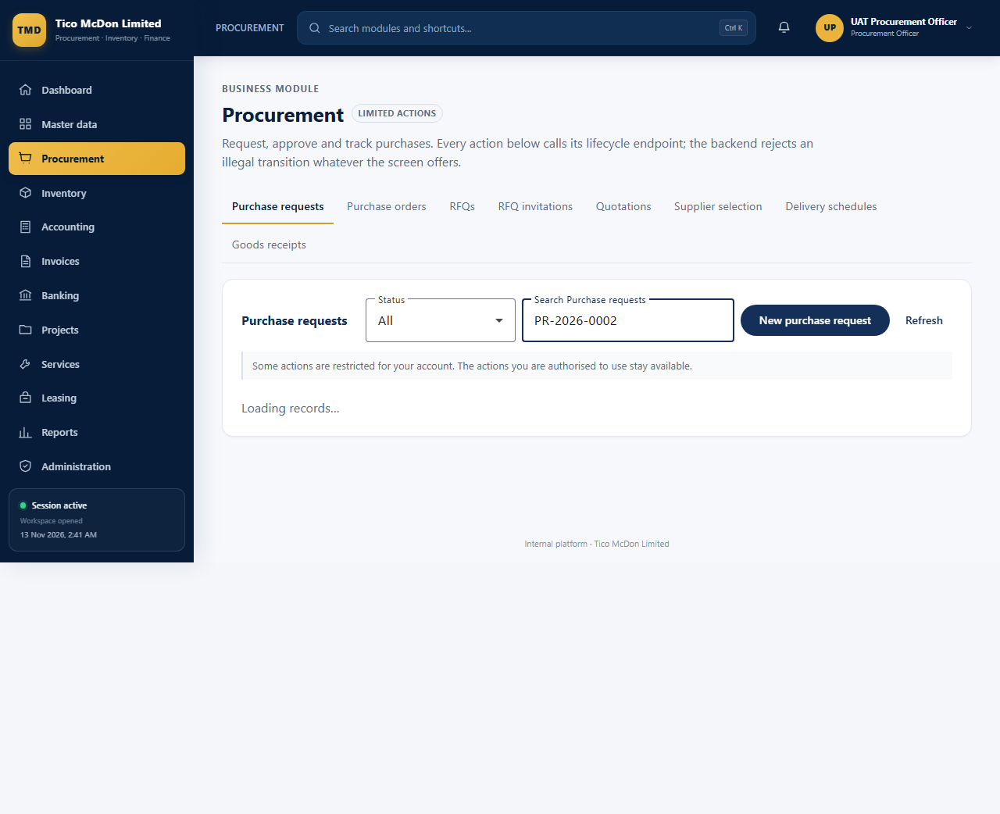
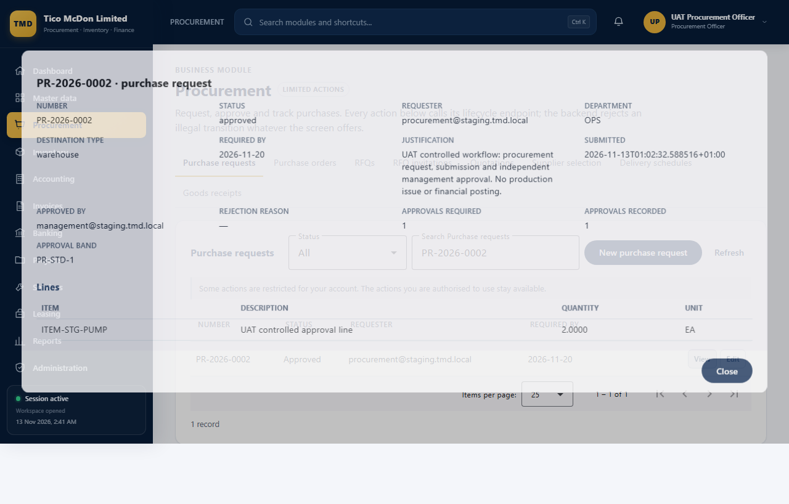
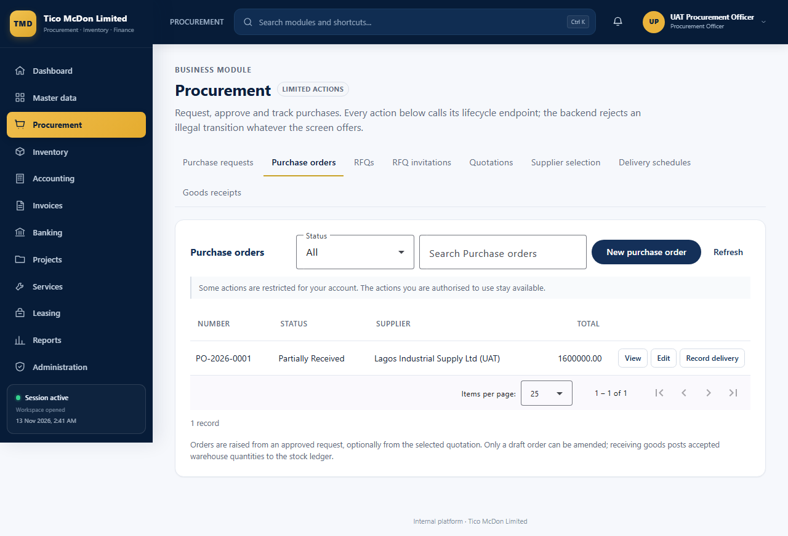
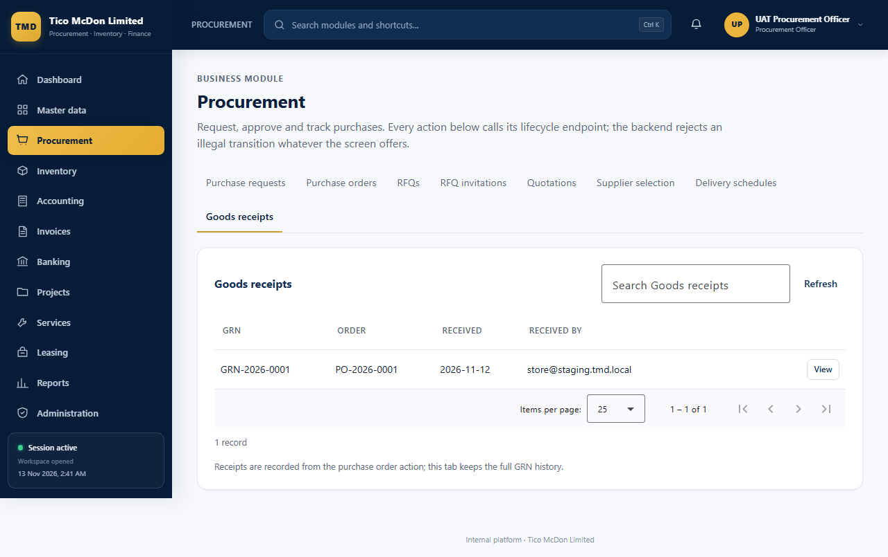

# Procurement User Acceptance Test Script

**System:** TMD Enterprise System  
**Business area:** Purchase requests, approval, purchase orders, goods receipt and procurement visibility  
**Primary role:** Procurement Officer  
**Supporting roles:** Management (approval), Storekeeper (receipt), Auditor (read-only)  
**UAT cycle:** 13 November 2026  
**Environment:** Isolated QA database `tmd_qa_adversarial_20261113`  
**Data:** Synthetic QA data; the controlled UAT request is `PR-2026-0002`  
**Technical execution:** Complete for the cases below  
**Formal acceptance:** **PENDING** Procurement and Management sign-off

## 1. Objective

Demonstrate the procurement lifecycle from request creation through independent approval, and confirm that purchase orders and goods receipts are traceable, restricted roles cannot perform procurement writes, and no purchasing action creates a production financial obligation.

## 2. Preconditions

- QA seed contains a warehouse destination, active catalogue item, unit of measure and department.
- Procurement Officer has `procurement.add_purchaserequest` and `change_purchaserequest`.
- Management has `procurement.approve_purchaserequest`.
- Auditor is read-only.
- No purchase order, supplier invoice or payment is issued by this script beyond the controlled QA record.

## 3. Test script and results

| ID | Business workflow / steps | Expected result | Actual result | Status | Evidence |
|---|---|---|---|---|---|
| PRC-01 | Sign in as Procurement Officer. Open Procurement. | Procurement workspace loads with Purchase requests, Purchase orders, RFQs and Goods receipts tabs; create action is available. | Workspace loaded; role could search the request register and see the create action. | **PASS** | `evidence/screenshots/procurement-01-approved-uat-request.png` |
| PRC-02 | Create a controlled request: destination, department, required-by date, justification and one positive line. Save as draft. | HTTP 201; status `draft`; requester is the Procurement Officer; the line quantity is positive. | Created `PR-2026-0002` with HTTP 201 and status `draft`. Line: `ITEM-STG-PUMP`, quantity `2.0000`, UAT justification. | **PASS** | `evidence/uat-api-probe.json` |
| PRC-03 | Submit the draft for approval. | Status moves to `submitted`; submitted timestamp is recorded; the request becomes non-editable. | HTTP 200; status `submitted`; submitted timestamp recorded. | **PASS** | `evidence/uat-api-probe.json` |
| PRC-04 | Sign in as Management. Approve the submitted request. | Management approves independently; status becomes `approved`; approval count is 1 of 1; approver is Management. | HTTP 200; status `approved`; `approved_by = management@staging.tmd.local`; required 1, recorded 1. | **PASS** | `evidence/screenshots/procurement-02-approval-detail.png`; `evidence/uat-api-probe.json` |
| PRC-05 | As requester, attempt to approve own request (negative control). | The backend rejects self-approval with a state conflict; no approval is recorded. | Automated backend regression covers this rule (`A request cannot be approved by its own requester`). It was not re-executed as a browser action in this UAT cycle; the API approval evidence confirms separate identities. | **PASS — backend regression; not re-executed** | Backend suite: 343 passed; `apps/procurement/services.py` |
| PRC-06 | Open Purchase orders. Verify the seeded chain. | `PO-2026-0001` is visible and linked to the approved request; partial receipt status is visible. | `PO-2026-0001` visible with status `partially_received`; QA database has one purchase order and one approved procurement request chain. | **PASS** | `evidence/screenshots/procurement-03-purchase-order.png`; `evidence/uat-api-probe.json` |
| PRC-07 | Open Goods receipts. Verify `GRN-2026-0001` and its received quantities. | The receipt is traceable to the purchase order and records accepted, damaged and rejected quantities. | `GRN-2026-0001` visible. Seeded UAT evidence records one damaged pump and zero rejected quantity; the purchase order remains partially received. | **PASS** | `evidence/screenshots/procurement-04-goods-receipt.png`; `docs/reports/evidence/workflow-checks.md` |
| PRC-08 | Sign in as Auditor. Open Procurement. | Auditor can inspect the register but the create action is disabled; no write is offered. | Register visible; create control disabled with the permission explanation; API `POST /purchase-requests/` returned 403. | **PASS** | `evidence/screenshots/audit-01-procurement-read-only.png`; `evidence/uat-api-probe.json` |
| PRC-09 | As Procurement Officer, open Banking. | Banking is restricted and no banking data API is requested. | “Access restricted” rendered; the browser made no `/banking-summary/`, `/company-bank-accounts/` or `/reconciliations/` request; no 403 console error. | **PASS** | `evidence/screenshots/restricted-procurement-banking.png`; Playwright UAT-SEC |
| PRC-10 | Confirm the boundary after approval. | No purchase order, supplier invoice, payment, production invoice, journal or bank execution is created by this UAT. | The controlled request remains an approved request only. The only PO/GRN/invoice records are the pre-existing synthetic seed records. | **PASS** | `evidence/uat-api-probe.json` |

## 4. End-to-end reference chain

The QA database contains the following synthetic chain, used as read-only UAT reference evidence:

| Step | Record | Observed state |
|---|---|---|
| Approved request | `PR-2026-0001` | approved |
| Purchase order | `PO-2026-0001` | partially received |
| Goods receipt | `GRN-2026-0001` | received with one damaged unit |
| Supplier invoice | `SI-2026-0001` | matched |
| Payment | `PAY-2026-0001` | recorded, not executed |

The new UAT approval (`PR-2026-0002`) deliberately stopped at “approved”. Converting it to a purchase order would create a new commitment and was outside the authorised UAT boundary.

## 5. Defects and conditions

- No open Procurement functional defect was found in the executed cases.
- UAT-D-001 was the restricted-module API preflight defect; it is fixed and retested.
- UAT-D-002, UAT-D-003 and UAT-D-004 remain cross-cutting management decisions.
- RFQ issue, quote evaluation and supplier selection were not re-executed in this cycle because no approved RFQ/quote UAT record was in scope. They remain part of the future business acceptance script.

## Visual evidence

## 6. Acceptance statement

> I confirm that the Procurement workflows above have been demonstrated and that I accept / accept with conditions / reject the Procurement business area.

| Field | Entry |
|---|---|
| Business representative | ______________________________ |
| Position | ______________________________ |
| Decision | ☐ Accept  ☐ Accept with conditions  ☐ Reject |
| Conditions / exceptions | ______________________________ |
| Signature | ______________________________ |
| Date | ______________________________ |

**Current formal status: NOT ACCEPTED — business sign-off outstanding.**
