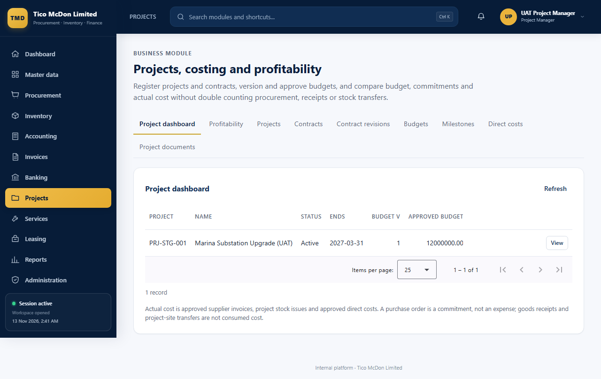
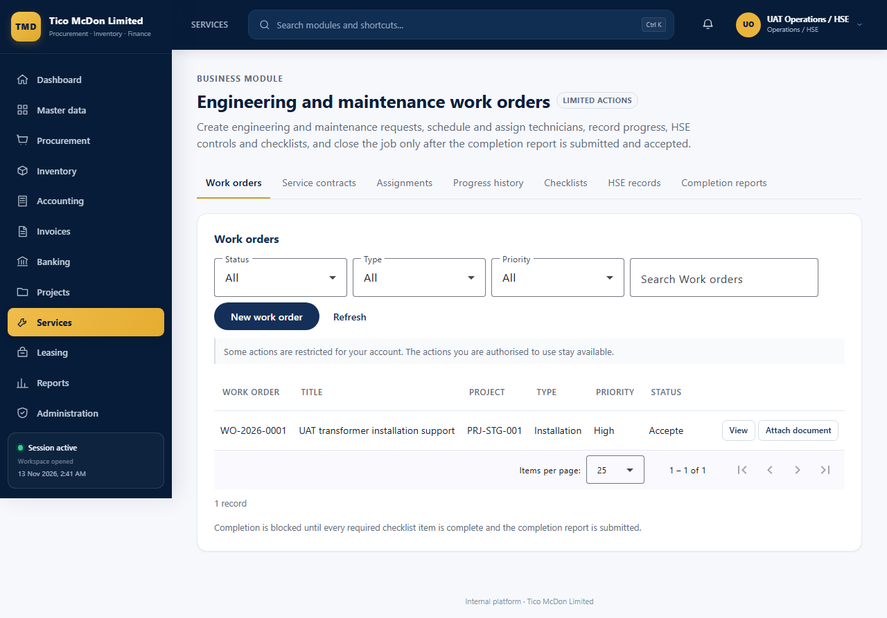
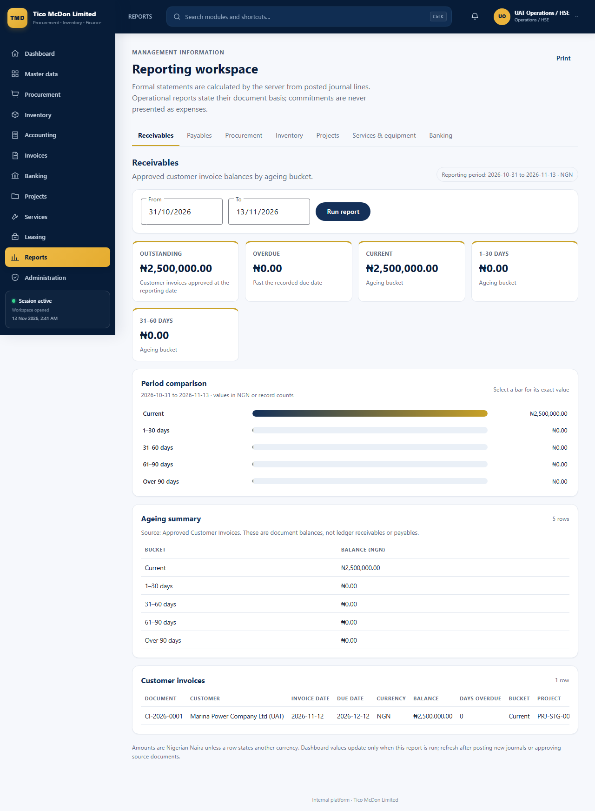
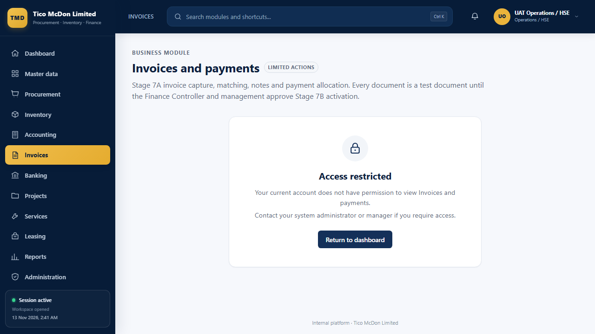
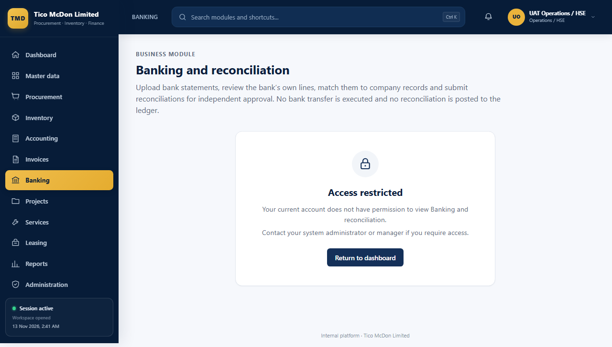

# Project Management and Operations/HSE User Acceptance Test Script

**System:** TMD Enterprise System  
**Business areas:** Projects, project cost visibility, service work orders, HSE operations and operational reporting  
**Primary roles:** Project Manager, Operations / HSE  
**Supporting roles:** Storekeeper (project issue), Finance (cost evidence)  
**UAT cycle:** 13 November 2026  
**Environment:** Isolated QA database `tmd_qa_adversarial_20261113`  
**Data:** `PRJ-STG-001`, `WO-2026-0001`, `ISS-2026-0001`, `RA-2026-0001`  
**Technical execution:** Complete for the cases below  
**Formal acceptance:** **PENDING** Project and Operations/HSE sign-off

## 1. Objective

Demonstrate that the Project Manager can see project status, budget/cost information and project-related stock issues; that Operations/HSE can manage service work orders and HSE activities; and that operational roles see only the information and reports necessary for their work.

## 2. Preconditions

- The synthetic project `PRJ-STG-001` exists with approved budget evidence.
- Service work order `WO-2026-0001` is accepted; rental agreement `RA-2026-0001` is closed.
- Project Manager and Operations/HSE accounts have their configured role permissions.
- No project budget approval, work order completion or rental closure is created by this script.

## 3. Project Management test script and results

| ID | Business workflow / steps | Expected result | Actual result | Status | Evidence |
|---|---|---|---|---|---|
| PRJ-01 | Sign in as Project Manager. Open Projects. | Project dashboard loads; the UAT project is visible with budget/actual cost indicators. | Projects loaded; `PRJ-STG-001` visible. The synthetic workflow evidence records budget status approved and actual cost `300000.00`. | **PASS** | `evidence/screenshots/project-01-project-dashboard.png`; `docs/reports/evidence/workflow-checks.md` |
| PRJ-02 | Review the project stock issue. | Material issued to the project is traceable and included in project cost. | `ISS-2026-0001` is linked to `PRJ-STG-001` with value `240000.00`. | **PASS** | `docs/reports/evidence/workflow-checks.md` |
| PRJ-03 | Review service delivery against the project. | Accepted work order is visible; no production invoice is issued. | `WO-2026-0001` is accepted; invoice records remain test documents. | **PASS** | `evidence/screenshots/operations-01-work-orders.png` |
| PRJ-04 | Review the equipment rental lifecycle. | Rental agreement is closed with movement, inspection and maintenance evidence. | `RA-2026-0001` status `closed`; synthetic evidence records two movements and no inspection damage. | **PASS** | `docs/reports/evidence/workflow-checks.md` |
| PRJ-05 | Attempt to open Banking. | Banking is restricted; no financial API calls are made. | “Access restricted”; zero banking data requests; no 403 console error. | **PASS** | Playwright UAT-SEC; `evidence/uat-api-probe.json` |
| PRJ-06 | Approve a new project budget or variation. | Approval requires the project budget permission and an independent approver. | Not executed in this cycle; requires a business-initiated budget variation. Existing approved budget evidence was reviewed read-only. | **NOT RUN — business witness required** | `docs/reports/evidence/workflow-checks.md` |

## 4. Operations / HSE test script and results

| ID | Business workflow / steps | Expected result | Actual result | Status | Evidence |
|---|---|---|---|---|---|
| OPS-01 | Sign in as Operations / HSE. Open Services. | Service workspace loads; work orders are visible; only permitted actions are offered. | Services loaded; `WO-2026-0001` accepted and visible. | **PASS** | `evidence/screenshots/operations-01-work-orders.png` |
| OPS-02 | Open Reports. | Operational reports are available; formal financial statements are not. | “Financial statements” button absent; “Receivables” operational report present. | **PASS** | `evidence/screenshots/operations-02-least-privilege-reports.png` |
| OPS-03 | Attempt to open Invoices. | The module is restricted and makes no invoice API request. | “Access restricted”; zero supplier/customer invoice data requests; no 403 console error. | **PASS** | `evidence/screenshots/restricted-operations-invoicing.png`; Playwright UAT-SEC |
| OPS-04 | Attempt to open Banking. | The module is restricted and makes no banking API request. | “Access restricted”; zero banking data requests; no 403 console error. | **PASS** | `evidence/screenshots/restricted-operations-banking.png`; Playwright UAT-SEC |
| OPS-05 | Attempt to open Administration. | Access is restricted; no access-administration data is rendered. | Direct `/access/users/` and `/access/roles/` returned 403; Administration page showed access restricted. | **PASS** | `evidence/uat-api-probe.json` |
| OPS-06 | Raise a purchase request from Operations. | An operational employee can raise a request within the existing Operations role, with no separate Requester role. | The Operations role has `procurement.add_purchaserequest`; this is the agreed “no General Requester role” design. A real Operations request was not created in this cycle. | **PASS — policy design; not re-executed** | `backend/apps/core/role_matrix.py`; `administration-uat.md` §5 |
| OPS-07 | Complete a new service work order through acceptance. | Work order transitions require the configured service permissions and acceptance evidence. | Not executed in this cycle; the accepted seeded work order was reviewed read-only. | **NOT RUN — business witness required** | `docs/reports/evidence/workflow-checks.md` |

## 5. Combined operational controls

| Control | Result |
|---|---|
| Project issue to cost | `ISS-2026-0001` value `240000.00` linked to `PRJ-STG-001` |
| Project budget status | Approved in synthetic workflow evidence |
| Service acceptance | `WO-2026-0001` accepted |
| Rental lifecycle | `RA-2026-0001` closed |
| Operations financial reports | Formal financial statements not offered |
| Operations invoices/banking | Restricted, no data API requests |
| Production invoice/NRS | Not activated |

## 6. Defects and conditions

- No open Project or Operations/HSE functional defect was found in the executed cases.
- UAT-D-001 is fixed.
- New budget variations and new work-order lifecycles were not created; those require the relevant business owners to witness the full transaction.
- UAT-D-004 (role matrix/General Requester) must be formally confirmed by Management.

## Visual evidence

## 7. Acceptance statement

> I confirm that the Project Management and Operations/HSE workflows above have been demonstrated and that I accept / accept with conditions / reject these business areas.

| Field | Entry |
|---|---|
| Project representative | ______________________________ |
| Operations/HSE representative | ______________________________ |
| Decision | ☐ Accept  ☐ Accept with conditions  ☐ Reject |
| Conditions / exceptions | ______________________________ |
| Signatures | ______________________________ |
| Date | ______________________________ |

**Current formal status: NOT ACCEPTED — business sign-off outstanding.**
