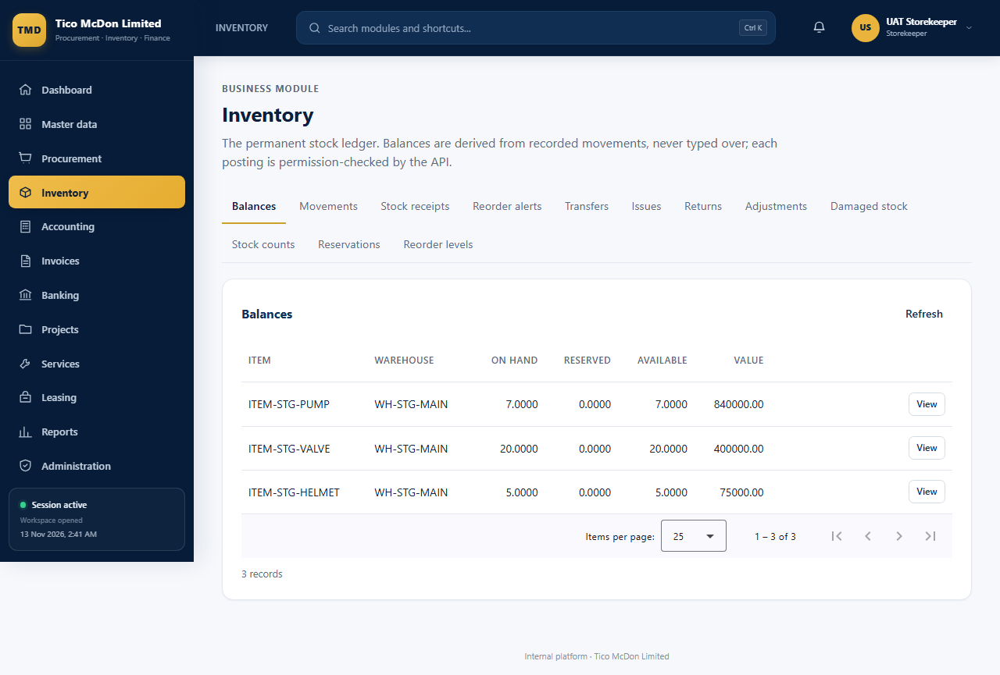
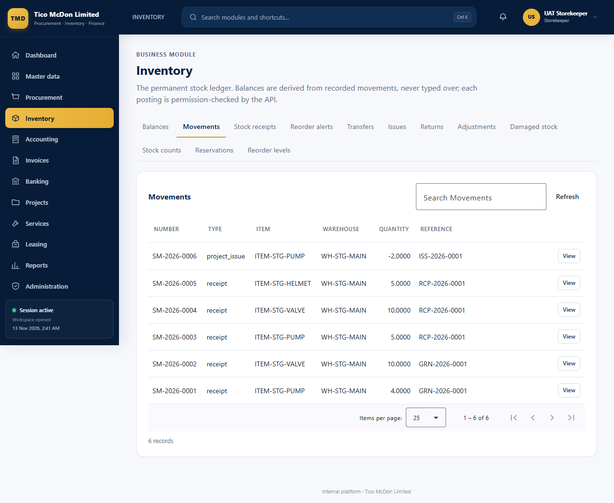
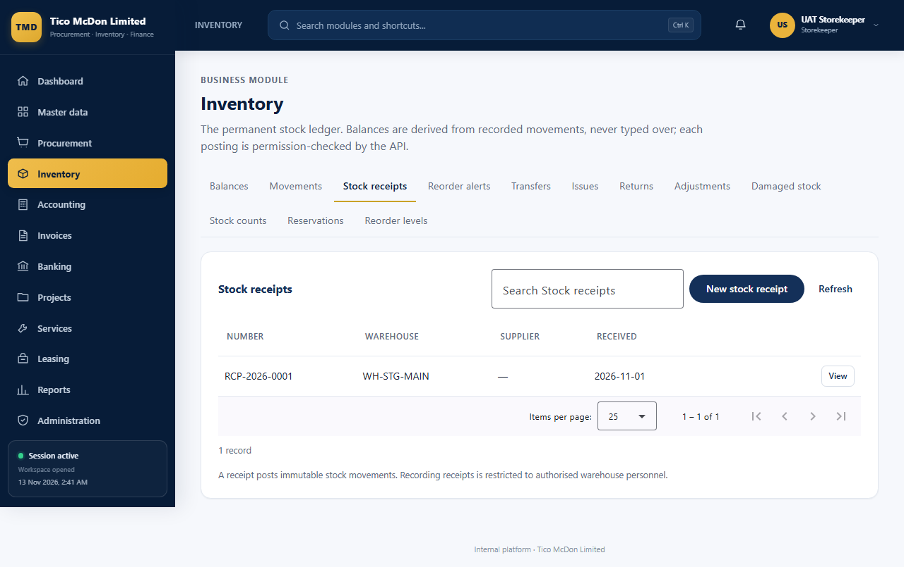

# Warehouse User Acceptance Test Script

**System:** TMD Enterprise System  
**Business area:** Stock receipt, issue, movement traceability and inventory valuation  
**Primary role:** Storekeeper  
**Supporting role:** Project Manager (project issue)  
**UAT cycle:** 13 November 2026  
**Environment:** Isolated QA database `tmd_qa_adversarial_20261113`  
**Data:** Synthetic stock, `ITEM-STG-PUMP`, warehouse UAT records  
**Technical execution:** Complete for the cases below  
**Formal acceptance:** **PENDING** Warehouse/Warehousing sign-off

## 1. Objective

Confirm that the Storekeeper can see the stock position and its value, trace receipts and movements to source documents, verify project issues, and access no financial or banking functions. Confirm that stock records reconcile to the inventory ledger.

## 2. Preconditions

- QA seed contains an active warehouse, item, unit of measure and project.
- Stock receipt `RCP-2026-0001` and stock issue `ISS-2026-0001` exist as synthetic UAT records.
- Storekeeper has inventory view and receiving permissions.
- No physical goods movement is created by this UAT script.

## 3. Test script and results

| ID | Business workflow / steps | Expected result | Actual result | Status | Evidence |
|---|---|---|---|---|---|
| WHS-01 | Sign in as Storekeeper. Open Inventory. | Inventory workspace loads; Balances tab is visible; only authorised actions are offered. | Inventory loaded; `ITEM-STG-PUMP` visible with value `840000.00`; Storekeeper had no banking or administration navigation rights. | **PASS** | `evidence/screenshots/warehouse-01-stock-valuation.png` |
| WHS-02 | Review the stock balance for the UAT item. | On hand, reserved and available quantities are consistent; value is the valuation of the on-hand quantity. | Balance row rendered with the UAT item, warehouse and `840000.00` stock value. The trial-balance reconciliation records inventory ledger equal to stock valuation. | **PASS** | `evidence/screenshots/warehouse-01-stock-valuation.png`; `docs/reports/evidence/staging-reconciliation.md` |
| WHS-03 | Open Movements. Trace the seeded receipt and project issue. | Movements show receipt/issue types, quantity, reference and value change; the project issue is traceable to `ISS-2026-0001`. | Movements loaded with `SM-2026-0006` and prior movements. The seeded issue is `ISS-2026-0001` to `PRJ-STG-001`, valued at `240000.00`. | **PASS** | `evidence/screenshots/warehouse-02-stock-movements.png`; `docs/reports/evidence/workflow-checks.md` |
| WHS-04 | Open Stock receipts. Verify `RCP-2026-0001`. | Receipt is visible with warehouse, supplier, date and received-by information. | `RCP-2026-0001` visible in the stock receipts register. | **PASS** | `evidence/screenshots/warehouse-03-stock-receipt.png` |
| WHS-05 | Review the partial/damaged delivery evidence. | Accepted, damaged and rejected quantities are recorded separately; damaged stock is not silently added to available stock. | Seeded delivery evidence records `damaged = 1.0000`, `rejected = 0.0000`, with reason “UAT: one pump damaged in transit”. | **PASS** | `docs/reports/evidence/workflow-checks.md` |
| WHS-06 | Review the project stock issue. | The issue reduces stock and charges the project; the value is visible to project reporting. | `ISS-2026-0001` is linked to `PRJ-STG-001`; issue value `240000.00`; project evidence records `actual_cost = 300000.00`. | **PASS** | `docs/reports/evidence/workflow-checks.md`; `evidence/screenshots/project-01-project-dashboard.png` |
| WHS-07 | Attempt to open Banking and Administration. | Both are restricted; no data APIs are called and no sensitive financial records render. | Both modules rendered “Access restricted”. Banking preflight made zero banking data requests and emitted no 403 console error. | **PASS** | `evidence/screenshots/restricted-warehouse-banking.png`; Playwright UAT-SEC |
| WHS-08 | Confirm the inventory control total. | Inventory ledger equals the stock valuation within 0.01. | The synthetic reconciliation reports inventory ledger equal to valuation; the ledger has no unreconciled stock control difference. | **PASS** | `docs/reports/evidence/staging-reconciliation.md` |
| WHS-09 | Create a new stock adjustment or write-off. | A valid adjustment requires a reason, permission and an auditable movement. | Not executed in this UAT cycle. The action remains available to authorised roles; no new stock adjustment was posted during acceptance testing. | **NOT RUN — business witness required** | `backend/apps/inventory/tests/` |
| WHS-10 | Perform a physical count and post it. | Count differences are reviewed and posted with an audit trail. | Not executed; requires a physical count witness and warehouse representative. | **NOT RUN — business witness required** | — |

## 4. Reconciliation result

| Control | Result |
|---|---|
| Stock valuation method | Configured and reported by the server |
| Inventory ledger vs valuation | Equal in the synthetic reconciliation |
| Project issue vs project cost | `ISS-2026-0001` value `240000.00` reflected in project actual cost |
| Negative stock | No negative available quantity observed in the UAT fixture |
| Damaged stock | Recorded separately; not treated as good stock |

## 5. Defects and conditions

- No open Warehouse functional defect was found in the executed read-only cases.
- Stock adjustment and physical count execution remain unexecuted and require a Warehouse representative present.
- UAT-D-001 is fixed; UAT-D-002/003/004 are cross-cutting management decisions.

## Visual evidence

## 6. Acceptance statement

> I confirm that the Warehouse workflows above have been demonstrated and that I accept / accept with conditions / reject the Warehouse business area.

| Field | Entry |
|---|---|
| Business representative | ______________________________ |
| Position | ______________________________ |
| Decision | ☐ Accept  ☐ Accept with conditions  ☐ Reject |
| Conditions / exceptions | ______________________________ |
| Signature | ______________________________ |
| Date | ______________________________ |

**Current formal status: NOT ACCEPTED — business sign-off outstanding.**
